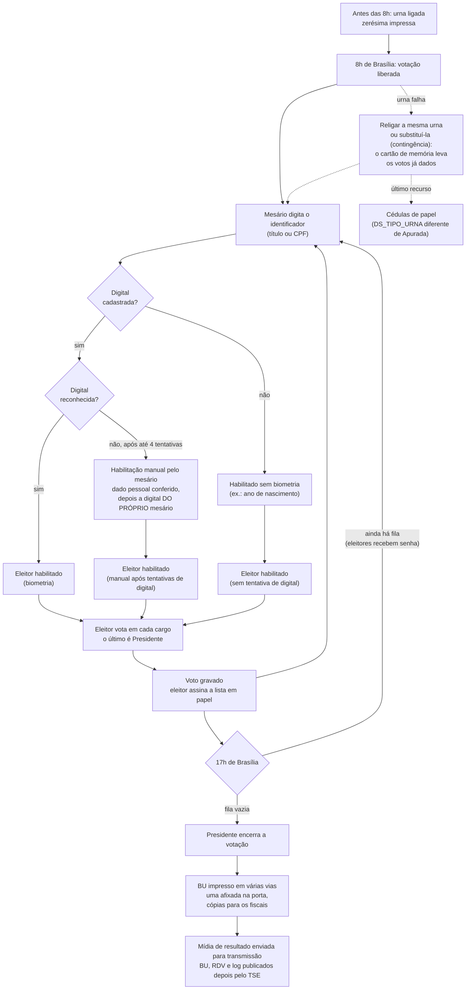

# Plano de Pesquisa — Votação após as 17h e Sinais de Voto Fraudulento nas Eleições Brasileiras

> **Versão em português de [RESEARCH_PLAN.md](RESEARCH_PLAN.md).** As duas versões têm o mesmo conteúdo e
> devem ser atualizadas juntas. Nomes de variáveis, colunas, arquivos e mensagens do log ficam como no original.

> Documento autossuficiente de passagem de bastão: a afirmação, as perguntas, as fontes de
> dados verificadas, as variáveis, cada etapa de análise e as checagens. Nada foi
> implementado ainda.

**Decisões de escopo**
- **Geografia:** os 27 estados (Brasil inteiro).
- **Eleições:** Presidente 2022, 1º e 2º turno (base principal), e 2026, 1º e 2º turno (replicação). O 2º turno de 2026 (25/10/2026) foi publicado pelo TSE em 26–27/10/2026 e está carregado nas tabelas brutas `_2t`.
- **Unidade de análise:** seção eleitoral × turno.

---

## 1. Afirmação em teste

Um relato de eleitores do Nordeste afirma que existe uma prática comum: depois do
encerramento às 17h, os mesários já sabem quais eleitores da seção não compareceram
e votam no nome deles.

O objetivo é **testar** a afirmação com dados públicos, não prová-la. Se a prática
existir em escala, ela deve deixar rastros mensuráveis nos logs das urnas e nos
resultados das seções. Se esses rastros não existirem, isso também é um resultado
válido.

**Restrição central (sigilo do voto):** nenhum arquivo público liga o horário de um
voto individual ao candidato escolhido. O log da urna tem horários, mas não tem
candidato; o RDV tem candidatos, mas está embaralhado. Toda análise por candidato é,
portanto, **ecológica** (no nível da seção), nunca no nível do voto.

### 1.1 Como funciona uma seção eleitoral, e o que cada etapa deixa nos dados

A afirmação trata do que acontece dentro de uma seção eleitoral, então a análise
precisa seguir o próprio procedimento da seção. Cada etapa abaixo lista o **rastro
nos dados** que ela deixa. As mensagens do log estão citadas exatamente como
aparecem nos arquivos `logd.dat` de 2026 (aplicação `VOTA`, salvo indicação). Regras
marcadas com *(confirmar)* vêm do conhecimento geral do procedimento e ainda precisam
ser conferidas na resolução do TSE para 2026.

**Quem está na seção**

| Papel | O que faz | Rastro nos dados públicos |
|---|---|---|
| Presidente da mesa | Abre e encerra a votação, decide sobre incidentes, assina a ata | Ações do operador no log ("Operador selecionou: Encerrar votação") |
| Mesários e secretários | Identificam os eleitores, digitam o identificador no terminal do mesário, habilitam manualmente quando a digital falha, colhem as assinaturas na lista de votação | Convocação em `convocacao_mesarios` (só uso agregado); no log, "Mesário N habilitou o eleitor" e os eventos de registro de mesários (os títulos deles **não** são guardados por este projeto) |
| Fiscais de partido e delegados | Acompanham abertura, votação e encerramento; podem registrar reclamações em ata e pedir cópia impressa do BU | **Nenhum.** A presença deles e a ata da seção não estão nos dados abertos, então afirmações sobre "seções sem fiscal" não podem ser testadas aqui |
| Juiz eleitoral e técnicos | Substituição de urna (contingência), recuperação de dados, apuração pela mesa quando se usa cédula | Eventos de contingência e de recuperação no log; `DS_TIPO_URNA`, arquivos de correspondência (CESP/CEFT) |

**Fluxo do dia**



**Rastro de cada etapa**

| Etapa | Mensagens do log (2026) | Outros arquivos |
|---|---|---|
| Zerésima e abertura | "Gerando relatório [ZERÉSIMA] [INÍCIO]", "Urna pronta para receber votos" (hora local da urna: 06:00:01 no Acre é 8h de Brasília) | `DT_ABERTURA` no BU (também em hora local) |
| Identificação do eleitor | "Aguardando digitação do identificador do eleitor", "Identificador do eleitor digitado pelo mesário", "Identificador digitado pelo mesário foi: (Título de eleitor)" ou "(CPF)" | — |
| Habilitação biométrica | "Solicita digital. Tentativa [N] de [4]", "Capturada a digital. Tentativa [N] de [4]", "Tipo de habilitação do eleitor [biométrica]" | — |
| Habilitação manual após falha da digital | Tentativas de digital, depois "Solicitação de dado pessoal do eleitor para habilitação manual", "Dado digitado confere", "Solicita digital do mesário" (a urna exige a digital do próprio mesário), "Mesário N habilitou o eleitor". Cada habilitação manual fica, portanto, ligada a um mesário registrado | `QT_ELEI_BIOM_SEM_HABILITACAO` no BU (total do dia, sem divisão por hora) |
| Habilitação sem nenhuma tentativa de digital | "Ano de nascimento digitado é igual ao do cadastro" (ou "… é diferente do cadastro") sem "Capturada a digital" antes | — |
| Voto | "Eleitor foi habilitado", "Voto confirmado para [Governador]" (onde há 2º turno para governador), "Voto confirmado para [Presidente]", "O voto do eleitor foi computado" | RDV (votos embaralhados), totais do BU |
| Encerramento | "Operador selecionou: Encerrar votação", "Todas as pessoas presentes já votaram? SIM", "Gerando relatório [BU] [INÍCIO]", "Gerando arquivo de resultado [bu.dat] + [Início]" | `DT_ENCERRAMENTO` (hora local), imagem do BU impresso (`imgbu.dat`) |
| Queda de energia / religamento | Aplicação `LOGD`: "Início das operações do logd", "Urna ligada em …"; o voto em andamento pode ficar sem "computado" (ver `tse.urna_logs`) | — |
| Urna de contingência | "Modo de carga da UE - Urna de contingência", "Início do procedimento de contingência", "Término do processo de contingência", depois o "Município / Zona Eleitoral / Seção Eleitoral" da própria seção | O log da urna original pode vir aninhado no pacote (`…-01.jez`, `…ME.jez`); arquivos de correspondência |
| Recuperação de dados | "Iniciando aplicação RECUPERADOR DE DADOS" (aplicação `GAP`), depois eventos da aplicação `RED` | O pacote pode trazer o log da urna de outra seção (filtrado por `tse.urna_logs.secoes_do_log`) |

**Regras a confirmar na resolução do TSE de 2026** *(confirmar)*
- Número de tentativas de digital antes da habilitação manual (os logs de 2026 mostram até "Tentativa [4] de [4]").
- Quais dados pessoais o mesário precisa conferir na habilitação manual, e se documento com foto é obrigatório.
- Procedimento para os eleitores na fila às 17h (senhas) e quem pode votar depois das 17h.
- Número de vias do BU impressas e quem tem direito a uma.
- Amostra do teste de integridade e seus resultados publicados.

**Onde a afirmação em teste se encaixa neste fluxo.** Um mesário que sabe, pela
lista em papel, quais eleitores não compareceram teria de digitar o identificador
deles depois das 17h e habilitá-los manualmente (o que exige a digital do próprio
mesário e fica registrado como "Mesário N habilitou o eleitor") ou sem biometria.
Esse caminho deixa: votos depois das 17h (`votes_after_17`), habilitação manual ou
sem digital (`nh_rate_after`), nenhuma atividade de votação logo antes das 17h
(`gap_before_17`) e votos mais próximos entre si do que um eleitor real conseguiria
(`interval_after_17`). São exatamente as variáveis das RQ1–RQ3.

---

## 2. Perguntas de pesquisa e hipóteses

**Pergunta principal:** Na eleição presidencial brasileira, as seções eleitorais
mostram sinais compatíveis com mesários votando no lugar de eleitores ausentes
depois das 17h, e esses sinais estão associados ao comparecimento e à votação dos
candidatos?

| # | Subpergunta | H₀ (nula) |
|---|---|---|
| RQ1 | A proporção de eleitores habilitados **sem biometria** é maior depois das 17h do que antes, dentro da mesma seção? | A taxa sem biometria depois das 17h não é maior do que antes das 17h. |
| RQ2 | Há seções com votos depois das 17h **sem fila** às 17h (nenhuma atividade nos últimos minutos antes do encerramento)? | Votos depois das 17h só ocorrem em seções com atividade contínua até as 17h. |
| RQ3 | Os votos depois das 17h vêm em **rajadas** (intervalos curtos e regulares entre votos)? | Os intervalos entre votos depois das 17h seguem a mesma distribuição de antes das 17h na mesma seção. |
| RQ4 | Seções com sinais RQ1–RQ3 fortes estão associadas a **comparecimento anormalmente alto**? | A intensidade do sinal não está associada ao comparecimento, com efeitos fixos de município. |
| RQ5 | A atividade depois das 17h está associada à **votação dos candidatos**? | A proporção de votos depois das 17h não está associada à votação dos candidatos, com efeitos fixos de município. |

RQ1–RQ3 testam o **mecanismo**; RQ4–RQ5 testam a **consequência**. Um sinal crível
precisa dos dois. Uma associação só na RQ5 não é evidência de fraude.

---

## 3. Fontes de dados (verificadas em dadosabertos.tse.jus.br, out/2026)

Todos os datasets podem ser listados pela API CKAN do portal, então nenhuma URL
precisa ficar fixa no código:

```
https://dadosabertos.tse.jus.br/api/3/action/package_search?q=2022
https://dadosabertos.tse.jus.br/api/3/action/package_show?id=<dataset-id>
```

### 3.1 Datasets

| Id do dataset (CKAN) | Conteúdo | Padrão de arquivo (cdn.tse.jus.br/estatistica/sead/…) | Tamanho |
|---|---|---|---|
| `resultados-2022-boletim-de-urna`, `resultados-2026-boletim-de-urna` | Boletim de urna (BU) em CSV: uma linha por seção × cargo × candidato | `eleicoes/eleicoes{Y}/buweb/bweb_{1t,2t}_{UF}_{timestamp}.zip` (+ `.sha512`) | Pequeno (AC 1t 2022: 6 MB) |
| `resultados-2022-arquivos-transmitidos-para-totalizacao`, `resultados-2026-arquivos-transmitidos-para-totalizacao` | Arquivos brutos da urna por seção: `.bu`, `.imgbu`, **`.logjez`** (log da urna, compactado em 7z), `.rdv`, `.vscmr` | `eleicoes/eleicoes{Y}/arqurnatot/bu_imgbu_logjez_rdv_vscmr_{Y}_{1t,2t}_{UF}.zip` | **Grande:** 2º turno 2022 AC 367 MB, PI 1,7 GB, SP 20 GB |
| `eleitorado-2022`, `eleitorado-2026` | Perfil do eleitorado **por seção** (idade, escolaridade etc.) | `odsele/perfil_eleitor_secao/perfil_eleitor_secao_{Y}_{UF}.zip` | Médio |
| `resultados-2022`, `resultados-2026` | Votos por seção (`votacao_secao_{Y}_BR.zip`, 271 MB), detalhe do comparecimento por seção (`detalhe_votacao_secao_{Y}.zip`, 244 MB), **linha do tempo da totalização** (`Historico_Totalizacao_Presidente_BR_{1T,2T}_2022.zip`) | `odsele/votacao_secao/…`, `odsele/detalhe_votacao_secao/…`, `eleicoes/eleicoes2022/Historico_Totalizacao_…` | Médio |
| `resultados-2022-correspondencias-esperadas-e-efetivadas-{1,2}-turno`, `resultados-2026-correspondencias-esperadas-e-efetivadas-{1,2}-turno` | Urna esperada vs. efetivada por seção (substituições de urna, contingência) | `eleicoes/eleicoes{Y}/correspesp/CESP_{t}_{UF}_*.zip` | Pequeno |
| `comparecimento-e-abstencao-2022` | Comparecimento/abstenção por perfil do eleitor | `odsele/perfil_comparecimento_abstencao/…` | Médio |
| `denuncias-eleitorais-2022`, `denuncias-eleitorais` (2026) | Denúncias feitas no app *Pardal*: município, cargo, tipo de irregularidade, link do processo no PJe | `odsele/denuncia/denuncia_{Y}.zip` | 1 MB |
| `mesarios-2022`, `mesarias-mesarios-e-funcoes-especiais-2026` | Convocação de mesários (só uso agregado) | `odsele/convocacao_mesarios/…` | Pequeno |
| `correspondencia-entre-numero-interno-e-modelo-da-urna-1` | Modelo da urna por número interno | `odsele/modelo_urna/modelourna_numerointerno.zip` | Pequeno |
| `resultados-2026-logs-do-sistema-de-preparacao-das-urnas-eletronicas-gedai-{1,2}-turno` | Logs do sistema de preparação das urnas (só contexto) | — | — |

### 3.2 Colunas do CSV do BU (cabeçalho verificado, `bweb_1t_AC_*.csv`, separado por `;`, Latin-1)

```
DT_GERACAO; HH_GERACAO; ANO_ELEICAO; CD_TIPO_ELEICAO; NM_TIPO_ELEICAO; CD_PLEITO; DT_PLEITO;
NR_TURNO; CD_ELEICAO; DS_ELEICAO; SG_UF; CD_MUNICIPIO; NM_MUNICIPIO; NR_ZONA; NR_SECAO;
NR_LOCAL_VOTACAO; CD_CARGO_PERGUNTA; DS_CARGO_PERGUNTA; NR_PARTIDO; SG_PARTIDO; NM_PARTIDO;
DT_BU_RECEBIDO; QT_APTOS; QT_COMPARECIMENTO; QT_ABSTENCOES; CD_TIPO_URNA; DS_TIPO_URNA;
CD_TIPO_VOTAVEL; DS_TIPO_VOTAVEL; NR_VOTAVEL; NM_VOTAVEL; QT_VOTOS; NR_URNA_EFETIVADA;
CD_CARGA_1_URNA_EFETIVADA; CD_CARGA_2_URNA_EFETIVADA; CD_FLASHCARD_URNA_EFETIVADA;
DT_CARGA_URNA_EFETIVADA; DS_CARGO_PERGUNTA_SECAO; DS_AGREGADAS; DT_ABERTURA; DT_ENCERRAMENTO;
QT_ELEITORES_BIOMETRIA_NH; DT_EMISSAO_BU; NR_JUNTA_APURADORA; NR_TURMA_APURADORA
```

Colunas mais importantes:

| Coluna | Uso |
|---|---|
| `DT_ABERTURA`, `DT_ENCERRAMENTO` | Horário de abertura/encerramento da urna; encerramento depois das 17h significa que a votação continuou depois das 17h |
| `QT_ELEITORES_BIOMETRIA_NH` | Eleitores **não habilitados por biometria** na seção (total do dia, sem divisão por horário) |
| `DT_BU_RECEBIDO` | Quando o TSE recebeu o BU, usado para o atraso de transmissão (P8) |
| `QT_APTOS`, `QT_COMPARECIMENTO`, `QT_ABSTENCOES` | Eleitores aptos, comparecimento, abstenção |
| `DS_TIPO_URNA` | APURADA / urna substituída / etc. |
| `NR_URNA_EFETIVADA` | Id da urna, ligado ao modelo via `modelourna_numerointerno` |
| `DS_AGREGADAS` | Seções agregadas, que exigem tratamento especial |
| `NR_VOTAVEL`, `QT_VOTOS` (com `DS_CARGO_PERGUNTA = Presidente`) | Votos por candidato na seção |

### 3.3 Duas camadas de análise

| Camada | Dados | O que responde | Custo |
|---|---|---|---|
| **Leve** | CSV do BU + perfil do eleitorado, Brasil inteiro | Quais seções encerraram depois das 17h; taxa geral sem biometria; comparecimento; votação dos candidatos; atraso de recebimento (RQ4, RQ5, P8, parte da RQ1) | Centenas de MB, minutos |
| **Completa** | Logs das urnas (`.logjez`), Brasil inteiro | Votos antes/depois das 17h, sem biometria **antes vs. depois** das 17h, intervalo sem fila, intervalos entre votos (RQ1–RQ3) | **Centenas de GB** nos 3 turnos, horas |

Faça primeiro a camada leve: é barata e já responde parte da pergunta.

### 3.4 Ainda desconhecido (resolver no piloto, etapa 5.2)

- Formato exato da linha do log dentro do `.logjez` (esperado: arquivo 7z com `logd.dat`, um evento por linha com horário, nível, id da urna, aplicação, mensagem, hash).
- **Textos exatos das mensagens** do log para:
  - eleitor habilitado por biometria;
  - falha da biometria, depois habilitado pelo mesário (identificador/documento digitado);
  - voto computado;
  - encerramento da urna.
- Não foi encontrada documentação oficial do TSE sobre as mensagens do log. Montar o dicionário de eventos empiricamente a partir de um estado pequeno e conferir com as análises de 2022 listadas na §10.

---

## 4. Variáveis (seção × turno)

| Variável | Definição | Fonte | Camada |
|---|---|---|---|
| `uf`, `cd_municipio`, `nr_zona`, `nr_secao`, `nr_local_votacao` | Chaves | BU | Leve |
| `registered` | `QT_APTOS` | BU | Leve |
| `turnout` | `QT_COMPARECIMENTO / QT_APTOS` | BU | Leve |
| `close_time` | `DT_ENCERRAMENTO` | BU | Leve |
| `closed_after_17` | `close_time > 17:00:00` (hora de Brasília) | Derivada | Leve |
| `minutes_after_17` | Minutos entre 17h e `close_time` | Derivada | Leve |
| `nh_rate` | `QT_ELEITORES_BIOMETRIA_NH / QT_COMPARECIMENTO` | BU | Leve |
| `cand_share_{x}` | Proporção dos votos válidos para Presidente de cada candidato | BU | Leve |
| `receipt_delay` | `DT_BU_RECEBIDO − DT_ENCERRAMENTO` | BU | Leve |
| `machine_model` | A partir de `NR_URNA_EFETIVADA` | BU + tabela de modelos | Leve |
| `replaced_machine` | `DS_TIPO_URNA` ≠ APURADA, ou o arquivo de correspondência mostra troca | BU / CESP | Leve |
| Idade, escolaridade, proporção com biometria cadastrada | Perfil do eleitorado da seção | Perfil | Leve |
| `votes_before_17`, `votes_after_17` | Votos computados antes/depois das 17h | Log | Completa |
| `share_after_17` | `votes_after_17 / votes_total` | Derivada | Completa |
| `nh_rate_before`, `nh_rate_after` | Taxa de habilitação sem biometria antes/depois das 17h | Log | Completa |
| `gap_before_17` | Minutos entre o último voto antes das 17h e as 17h | Log | Completa |
| `interval_after_17` (mediana, p10) | Segundos entre votos consecutivos depois das 17h | Log | Completa |
| `burst_count` | Sequências de ≥ N votos consecutivos sem biometria com intervalo < S segundos | Log | Completa |
| `last_vote_time` | Horário do último voto computado | Log | Completa |

---

## 5. O que precisa ser feito (passo a passo)

### 5.1 Camada leve: BU do Brasil inteiro
- [ ] Listar os recursos pela API CKAN para `resultados-{2022,2026}-boletim-de-urna` (27 UFs × 3 turnos = 81 arquivos) e `eleitorado-{2022,2026}` (perfil por seção).
- [ ] Baixar e conferir com o `.sha512` onde houver.
- [ ] Filtrar `DS_CARGO_PERGUNTA = Presidente`; reduzir a **uma linha por seção** com as variáveis da §4.
- [ ] Tratar seções agregadas (`DS_AGREGADAS`) e urnas substituídas (`DS_TIPO_URNA`, arquivos CESP).
- [ ] **Checagem:** os totais nacionais do 2º turno de 2022 devem bater com o resultado oficial (Lula 60.345.999; Bolsonaro 58.206.354). O número de seções por UF deve bater com `detalhe_votacao_secao`.

### 5.2 Piloto dos logs (um estado pequeno)
- [ ] Baixar `bu_imgbu_logjez_rdv_vscmr_2022_2t_AC.zip` (367 MB).
- [ ] Abrir alguns `.logjez` (7z) e ler o `logd.dat` bruto.
- [ ] Montar o **dicionário de eventos** (§3.4): texto da mensagem → categoria.
- [ ] Extrair as variáveis do log por seção da §4.
- [ ] **Conciliar:** os votos computados no log devem ser iguais ao `QT_COMPARECIMENTO` do BU. Meta ≥ 99% de seções conferindo; listar as que não conferem em vez de descartá-las.
- [ ] Revisar o dicionário e a taxa de conciliação **antes** de escalar.

### 5.3 Logs do Brasil inteiro
- [ ] Processar **um estado por vez** (baixar o zip → ler só os `.logjez` → gravar as variáveis por seção → apagar o zip), para que o uso de disco fique perto do tamanho do maior zip (SP ≈ 20 GB).
- [ ] Ordem: estados menores primeiro, SP por último; manter um arquivo de progresso para poder retomar.
- [ ] Repetir para 2022 1t, 2022 2t e 2026 1t.

### 5.4 Montar o painel
- [ ] Juntar BU + variáveis do log + perfil do eleitorado por (`uf`, `cd_municipio`, `nr_zona`, `nr_secao`, turno).
- [ ] Ligar 2022 1t ↔ 2t (mesmas seções) e 2022 ↔ 2026, onde as chaves de seção forem estáveis.

---

## 6. Pontos de análise

### P0 — Qualidade dos dados
- [ ] Tabela de conciliação log vs. BU (por UF e turno).
- [ ] Marcar e relatar: urnas substituídas, votos em contingência, seções agregadas, voto em trânsito, anomalias de relógio (eventos antes da abertura ou depois do encerramento).

### P1 — Quadro descritivo (camada leve)
- [ ] Distribuição de `close_time` por UF/região; % de seções que encerraram depois das 17h, e quanto depois.
- [ ] `nh_rate` por UF, região, perfil etário e modelo de urna (a linha de base legítima).
- [ ] Comparecimento e votação dos candidatos por região.

### P2 — Mecanismo: habilitação sem biometria (RQ1, camada completa)
- [ ] Comparação pareada `nh_rate_after` vs `nh_rate_before` dentro de cada seção (Wilcoxon de postos sinalizados; tamanho de efeito *r*).
- [ ] Repetir por região; testar se o Nordeste difere **depois de controlar** por idade, escolaridade e cadastro biométrico.

### P3 — Mecanismo: votação sem fila (RQ2, camada completa)
Votação legítima depois das 17h exige pessoas já na fila às 17h, então deve haver
atividade contínua logo antes do encerramento.
- [ ] Contar seções com `votes_after_17 > 0` **e** `gap_before_17` > X minutos.
- [ ] Descrever essas seções: número de votos depois das 17h, como foram habilitados, intervalos.

### P4 — Mecanismo: rajadas (RQ3, camada completa)
- [ ] Comparar a distribuição dos intervalos antes vs. depois das 17h dentro de cada seção (Kolmogorov–Smirnov ou Mann–Whitney).
- [ ] Estimar o tempo físico mínimo por voto (habilitação + todos os cargos + confirmação) com os dados de antes das 17h; marcar intervalos abaixo dele.
- [ ] Contar sequências de votos consecutivos sem biometria (`burst_count`).

### P5 — Consequência: comparecimento (RQ4)
- [ ] **Impressão digital da eleição** (Klimek et al., 2012): histograma 2D de comparecimento × votação do candidato por seção, por região e turno. Votos fraudulentos aparecem como um aglomerado perto de 100% de comparecimento com votação alta para um candidato.
- [ ] Regressão `turnout ~ signal + controles + EF de município`, com erros agrupados por município.

### P6 — Consequência: votação (RQ5)
- [ ] Camada leve: `cand_share ~ closed_after_17 + minutes_after_17 + nh_rate + controles + EF de município`.
- [ ] Camada completa: `cand_share ~ share_after_17 + nh_rate_after + controles + EF de município`.
- [ ] **Mudança dentro da seção entre turnos (2022):** Δ`share_after_17` vs Δ`cand_share`; cada seção serve de controle para si mesma.

### P7 — Robustez e placebos
- [ ] **Cortes placebo:** repetir P2–P6 com 16h e 16h30 como horário de "encerramento". Se o efeito também aparecer ali, não tem a ver com o encerramento.
- [ ] **Replicação no 1º turno de 2026** com o mesmo código e os mesmos limites.
- [ ] Sensibilidade aos limites (X minutos, N votos, S segundos), com valores fixados **antes** de olhar os resultados.
- [ ] Linha de base opcional de 2018 (o encerramento era às 17h em hora *local*, então o corte varia por estado).

### P8 — Atraso de transmissão (afirmação separada: "alguns estados demoram demais para enviar os resultados")
- [ ] `receipt_delay` por UF e município (camada leve).
- [ ] O atraso se explica pela distância (zona rural, Amazônia, transmissão via satélite) ou está associado aos sinais de P2–P4?
- [ ] Usar `Historico_Totalizacao_Presidente_BR_{1T,2T}_2022` para mostrar como a apuração nacional evoluiu durante a noite.

### P9 — Denúncias formais (contexto)
- [ ] Das denúncias do Pardal (`denuncia_2022`, `denuncia_2026`): contar denúncias por tipo de irregularidade e município, e verificar se essa prática foi formalmente denunciada, e onde.
- [ ] Comparar os municípios com denúncias com seções marcadas vs. não marcadas (só agregado).

---

## 7. Explicações alternativas a descartar

| Padrão observado | Explicação inocente | Como controlar |
|---|---|---|
| Muitos votos depois das 17h | Fila no horário de encerramento | `gap_before_17` (P3) |
| Mais habilitação sem biometria | Digitais gastas (trabalho manual), eleitores idosos, leitores com defeito | Perfil de idade/escolaridade, modelo de urna, proporção com biometria cadastrada |
| Padrão regional correlacionado com um candidato | O Nordeste tem preferência política diferente **e** demografia diferente | Efeitos fixos de município, mudanças dentro da seção |
| "Encerramento" muito cedo no Oeste | Horário unificado de Brasília (encerra às 15h locais no Acre) | Usar a hora de Brasília de forma consistente |
| Resultados atrasados | Logística (áreas remotas, satélite) | P8 |
| Horários estranhos no log | Erros de relógio da urna, urnas substituídas | Marcações do P0 |

---

## 8. Regra de interpretação (fixar antes de rodar)

Uma seção só conta como **anomalia** se cumprir as três condições:
1. votos depois das 17h sem nenhuma atividade nos X minutos antes das 17h;
2. votos depois das 17h majoritariamente habilitados sem biometria;
3. intervalos abaixo do mínimo físico, ou em rajadas.

Relatar: número e % de seções anômalas, sua distribuição geográfica, seu
comparecimento e votação comparados com outras seções do mesmo município, e
**o número máximo de votos que podem ter sido afetados**. Comparar esse número
com a margem nacional de vitória.

Registrar X, N e S (e a justificativa) **antes** de calcular a tabela de anomalias.

---

## 9. Limitações e ética

- Inferência ecológica: associações no nível da seção não revelam votos individuais.
- Uma anomalia é um **indício**, não uma prova; só uma auditoria ou investigação pode confirmá-la.
- Problemas de relógio e de formato dos eventos do log podem criar sinais falsos (P0).
- Não nomear mesários nem acusar seções específicas publicamente; relatar agregados.
- Os dados são públicos; não usar nada além do que o TSE publica.

---

## 10. Trabalhos anteriores para ler

- Klimek, P., Yegorov, Y., Hanel, R., & Thurner, S. (2012). Statistical detection of systematic election irregularities. *PNAS, 109*(41), 16469–16473.
- Mebane, W. R. — *Election Forensics* (testes baseados em comparecimento e em dígitos, e seus limites).
- Partido Liberal / Instituto Voto Legal (2022). *Relatório Técnico — Logs Inválidos das Urnas Eletrônicas* (v0.7, 15/11/2022), e a resposta do TSE.
- Análise independente de pesquisadores da USP/UFSCar/UFPA e outros sobre a questão dos logs (Poder360, dez/2022): https://static.poder360.com.br/2022/12/Analise-Bug04030201_USPUFSCarUFPAoutros.pdf
- Virgolino, V. A. C. (2023). *UrnaLogs* — trabalho de conclusão de curso, UFCG (coleta e organização dos logs de 2022 por seção): https://bdtd.ufcg.edu.br/jspui/bitstream/riufcg/30487/1/VICTOR%20ARRUDA%20C%c3%82MARA%20VIRGOLINO%20-%20TCC%20ARTIGO%20CI%c3%8aNCIA%20DA%20COMPUTA%c3%87%c3%83O%20CEEI%202023.pdf
- Checagens de fatos sobre "votos depois das 17h" e sobre os logs (Comprova/Metrópoles, O Popular, 2022). Listar cada argumento que levantam e garantir que a análise trate de cada um.
- Glossário de TI do TSE (verificação biométrica vs. identificação): https://www.tse.jus.br/institucional/catalogo-de-publicacoes/arquivos/glossario-ti

---

## 11. Entregas esperadas

1. Painel por seção (2022 1t, 2022 2t, 2026 1t, todas as UFs) com as variáveis da §4.
2. Dicionário de eventos do log e relatório de conciliação (P0).
3. Relatório descritivo e figuras (P1, impressões digitais da eleição, mapas de horário de encerramento).
4. Testes de hipótese RQ1–RQ5 com tamanhos de efeito, resultados dos placebos e a replicação de 2026.
5. Tabela de anomalias (agregada), com o máximo de votos afetados comparado com a margem.
6. Conclusão escrita: se a evidência sustenta a afirmação, e suas limitações.
