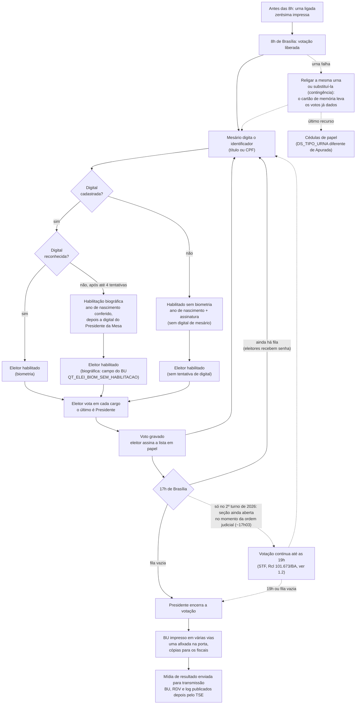

# Plano de Pesquisa — Votação após as 17h nas Eleições Presidenciais: Teste Estatístico de uma Afirmação sobre Votos por Ausentes

> **Versão em português de [RESEARCH_PLAN.md](RESEARCH_PLAN.md).** As duas versões têm o mesmo conteúdo e
> devem ser atualizadas juntas. Nomes de variáveis, colunas, arquivos e mensagens do log ficam como no original.

> Documento autossuficiente de passagem de bastão: a afirmação, as perguntas, as fontes de
> dados verificadas, as variáveis, cada etapa de análise e as checagens.

> **Natureza do trabalho:** estudo estatístico independente com dados públicos do TSE.
> Não é auditoria oficial nem perícia.

**Decisões de escopo**
- **Geografia:** os 27 estados (Brasil inteiro); seções do exterior (ZZ) analisadas em separado.
- **Eleições:** só Presidente 2026. O **1º turno é a base confirmatória principal**; o **2º turno é um estrato separado** (cédula diferente e o regime das 19h por ordem judicial, §1.2). Parte dos dados de 2026 foi vista antes do congelamento do protocolo; isso está declarado em `docs/registro_previo.md`, e essas análises contam como exploratórias. 2022 é uma replicação futura opcional, fora deste estudo.
- **Unidade de análise:** seção eleitoral × turno.

---

## 1. Afirmação em teste

Um relato atribuído a eleitores afirma que existe uma prática comum: depois do
encerramento às 17h, os mesários já sabem quais eleitores da seção não compareceram
e votam no nome deles. O teste é nacional; o Nordeste é um subgrupo definido de
antemão.

O objetivo é **testar** a afirmação com dados públicos, não prová-la. Se a prática
existir em escala, ela deve deixar rastros mensuráveis nos logs das urnas e nos
resultados das seções. Se esses rastros não existirem, isso também é um resultado
válido, limitado à forma da prática descrita aqui (§8).

**Restrição central (sigilo do voto):** nenhum arquivo público liga o horário de um
voto individual ao candidato escolhido. O log da urna tem horários, mas não tem
candidato; o RDV tem candidatos, mas está embaralhado. Toda análise por candidato é,
portanto, **ecológica** (no nível da seção), nunca no nível do voto.

### 1.1 Como funciona uma seção eleitoral, e o que cada etapa deixa nos dados

A afirmação trata do que acontece dentro de uma seção eleitoral, então a análise
precisa seguir o próprio procedimento da seção. Cada etapa abaixo lista o **rastro
nos dados** que ela deixa. As mensagens do log estão citadas exatamente como
aparecem nos arquivos `logd.dat` de 2026 (aplicação `VOTA`, salvo indicação). Regras
marcadas com *(confirmar)* vêm do conhecimento geral do procedimento e ainda precisam
ser conferidas na resolução do TSE para 2026.

**Quem está na seção**

| Papel | O que faz | Rastro nos dados públicos |
|---|---|---|
| Presidente da mesa | Abre e encerra a votação, decide sobre incidentes, assina a ata | Ações do operador no log ("Operador selecionou: Encerrar votação") |
| Mesários e secretários | Identificam os eleitores, digitam o identificador no terminal do mesário, habilitam manualmente quando a digital falha, colhem as assinaturas na lista de votação | Convocação em `convocacao_mesarios` (só uso agregado); no log, "Mesário N habilitou o eleitor" e os eventos de registro de mesários (os títulos deles **não** são guardados por este projeto) |
| Fiscais de partido e delegados | Acompanham abertura, votação e encerramento; podem registrar reclamações em ata e pedir cópia impressa do BU | **Nenhum.** A presença deles e a ata da seção não estão nos dados abertos, então afirmações sobre "seções sem fiscal" não podem ser testadas aqui |
| Juiz eleitoral e técnicos | Substituição de urna (contingência), recuperação de dados, apuração pela mesa quando se usa cédula | Eventos de contingência e de recuperação no log; `DS_TIPO_URNA`, arquivos de correspondência (CESP/CEFT) |

**Fluxo do dia**



**Rastro de cada etapa**

| Etapa | Mensagens do log (2026) | Outros arquivos |
|---|---|---|
| Zerésima e abertura | "Gerando relatório [ZERÉSIMA] [INÍCIO]", "Urna pronta para receber votos" (hora local da urna: 06:00:01 no Acre é 8h de Brasília) | `DT_ABERTURA` no BU (também em hora local) |
| Identificação do eleitor | "Aguardando digitação do identificador do eleitor", "Identificador do eleitor digitado pelo mesário", "Identificador digitado pelo mesário foi: (Título de eleitor)" ou "(CPF)" | — |
| Habilitação biométrica | "Solicita digital. Tentativa [N] de [4]", "Capturada a digital. Tentativa [N] de [4]", "Tipo de habilitação do eleitor [biométrica]" | — |
| Habilitação biográfica (após 4 falhas da digital) | Tentativas de digital, depois "Solicitação de dado pessoal do eleitor para habilitação manual", "Dado digitado confere", "Solicita digital do mesário" (a urna exige a digital do próprio mesário), "Mesário N habilitou o eleitor". A digital é a do Presidente da Mesa (Manual do Mesário 2026, p. 21). Só ~60–66% desses votos têm "Mesário N habilitou o eleitor"; os demais mostram "Biometria coletada não é do mesário…" ou "Não é possível associar a habilitação a um mesário" (presidente não registrado na urna) | `QT_ELEI_BIOM_SEM_HABILITACAO` no BU (total do dia, sem divisão por hora); correlação de 0,996 por seção com este caminho do log |
| Habilitação sem biometria (sem digital cadastrada) | "Ano de nascimento digitado é igual ao do cadastro" (ou "… é diferente do cadastro") sem "Capturada a digital" ou "Solicitação de dado pessoal…" antes. Sem digital de mesário | Não entra no campo do BU |
| Voto | "Eleitor foi habilitado", "Voto confirmado para [Governador]" (onde há 2º turno para governador), "Voto confirmado para [Presidente]", "O voto do eleitor foi computado" | RDV (votos embaralhados), totais do BU |
| Encerramento | "Operador selecionou: Encerrar votação", "Todas as pessoas presentes já votaram? SIM", "Gerando relatório [BU] [INÍCIO]", "Gerando arquivo de resultado [bu.dat] + [Início]" | `DT_ENCERRAMENTO` (hora local), imagem do BU impresso (`imgbu.dat`) |
| Queda de energia / religamento | Aplicação `LOGD`: "Início das operações do logd", "Urna ligada em …"; o voto em andamento pode ficar sem "computado" (ver `tse.urna_logs`) | — |
| Urna de contingência | "Modo de carga da UE - Urna de contingência", "Início do procedimento de contingência", "Término do processo de contingência", depois o "Município / Zona Eleitoral / Seção Eleitoral" da própria seção | O log da urna original pode vir aninhado no pacote (`…-01.jez`, `…ME.jez`); arquivos de correspondência |
| Recuperação de dados | "Iniciando aplicação RECUPERADOR DE DADOS" (aplicação `GAP`), depois eventos da aplicação `RED` | O pacote pode trazer o log da urna de outra seção (filtrado por `tse.urna_logs.secoes_do_log`) |

**Regras de procedimento (conferidas no Manual do Mesário 2026, TSE)**
- **Confirmada:** até 4 tentativas de digital antes da habilitação biográfica (Manual pp. 18 e 21; os logs mostram "Tentativa [4] de [4]").
- **Confirmada:** a habilitação biográfica exige documento com foto (p. 9), o ano de nascimento e a digital do Presidente da Mesa (p. 21); depois o eleitor assina o caderno.
- **Confirmada:** a votação só pode ser encerrada a partir das 17h de Brasília; as senhas vão para todos na fila, da última à primeira pessoa (pp. 7 e 24).
- **Não confirmada (texto do Ofício não encontrado):** 2º turno de 2026: quem podia votar entre 17h e 19h nas seções ainda abertas (qualquer eleitor que chegasse ou só quem tinha senha), conforme o Ofício-Circular GAB-PRES nº 354/2026 (ver §1.2).
- **Confirmada:** 5 vias obrigatórias do BU mais até 5 adicionais, para a Junta, a porta, o Presidente, os dois últimos eleitores, fiscais, MP ou imprensa que pedirem (p. 25).
- **Não confirmada:** amostra do teste de integridade e resultados consolidados de 2026 (só notícias regionais, cerca de 20 a 35 urnas por UF).

**Onde a afirmação em teste se encaixa neste fluxo.** Um mesário que sabe, pela
lista em papel, quais eleitores não compareceram teria de digitar o identificador
deles depois das 17h e habilitá-los biograficamente (o que exige a digital do
Presidente da Mesa e costuma ficar registrado como "Mesário N habilitou o eleitor")
ou, para eleitores sem digital cadastrada, só pelo ano de nascimento (sem nenhuma
digital de mesário). Esse caminho deixa: votos depois das 17h (`votes_after_17`), habilitação biográfica ou
sem biometria (`bio_rate_after`, `semdig_rate_after`), nenhuma atividade de votação logo antes das 17h
(`gap_before_17`) e votos mais próximos entre si do que um eleitor real conseguiria
(`interval_after_17`). São exatamente as variáveis das RQ1–RQ3.

### 1.2 Exceção no 2º turno de 2026: votação prorrogada até as 19h

O fluxo acima é o do dia normal. No 2º turno de **25 de outubro de 2026** o
horário de encerramento foi alterado **durante o dia da eleição** por uma ordem
judicial. Nesse turno, um voto dado entre 17h e 19h numa seção que ainda estava
aberta **estava autorizado pela ordem judicial então vigente** (alcance exato pendente do
Ofício, §1.1) e não exige fila às 17h. Todo corte de 17h deste plano tem de
ser lido com essa exceção para o 2026 2t (ver §4, §6, §8).

**Quem decidiu e como**

| Item | Fato |
|---|---|
| Decisão | Liminar monocrática que prorrogou o encerramento do recebimento dos votos "por duas horas, até as 19h, horário de Brasília" |
| Relator | Ministro **Cristiano Zanin**, Supremo Tribunal Federal (**STF**) |
| Processo | **Reclamação nº 101.673/BA** |
| Quem pediu | Coligação "Brasil Pronto Pra Mais" (Lula, PT). A campanha de Flávio Bolsonaro (PL) também havia pedido ao TSE prorrogação em municípios de SP, PR, MG, RS e SC, alegando chuvas e alagamentos |
| Fundamento | Suposto descumprimento, por Salvador, Feira de Santana e Lauro de Freitas (BA), da **ADPF 1.013**, decisão do STF que obriga o poder público a oferecer transporte público gratuito, com frequência de dia útil, em dia de eleição |
| Alcance | A reclamação citava 3 municípios da Bahia; a ordem foi estendida a todo o país. Zanin depois esclareceu que valia **só onde as urnas ainda não tinham sido encerradas**; os votos das urnas já fechadas foram totalizados normalmente. Urnas fechadas não foram reabertas |
| Cumprimento | O presidente do TSE, ministro Kassio Nunes Marques, cumpriu a ordem pelo Ofício-Circular GAB-PRES nº 354/2026: as seções ainda abertas ficaram abertas até as 19h. O TSE bloqueou temporariamente o recebimento dos BUs |
| Posições | O Ministério Público Eleitoral se manifestou contra a prorrogação. Nunes Marques disse que a liminar, proferida depois do horário de encerramento, "gerou dificuldades ao processo eleitoral" e que "nunca, na história do TSE, houve qualquer prorrogação" |

**Linha do tempo do dia (hora de Brasília, segundo a imprensa)**

| Horário | Evento |
|---|---|
| 13h22 e 15h42 | A coligação de Lula apresenta pedidos de prorrogação ao **TSE** |
| 16h22 | A coligação apresenta a Reclamação ao **STF**, pedindo efeito nacional |
| 16h33 | Processo distribuído ao ministro Zanin |
| 17h | Horário legal de encerramento |
| ~17h03 | A decisão de Zanin é divulgada |
| Depois | Zanin esclarece: só urnas ainda não encerradas; o TSE expede o Ofício-Circular 354/2026 |
| 19h | Novo horário de encerramento para as seções ainda abertas |

**Competência: STF × TSE.** As eleições são conduzidas pela Justiça Eleitoral,
cujo órgão máximo é o **Tribunal Superior Eleitoral (TSE)**. A ordem veio do
**STF**, não do TSE. As duas leituras ficam registradas aqui, cada uma com sua
fonte; este plano não decide entre elas:
- *Crítica:* a ordem "atropelou o TSE", que era quem deveria decidir os pedidos
  das campanhas (Poder360); o presidente do TSE criticou a liminar e o MP
  Eleitoral foi contra.
- *Contra-argumento:* a reclamação é o instrumento para garantir o cumprimento
  das decisões do próprio STF, e o pedido foi apresentado como descumprimento da
  ADPF 1.013, uma decisão do STF (Migalhas).

**Sobre o relator.** Registro de contexto sem efeito na análise: ver o Anexo A.

**Contestações depois do turno (registradas, não avaliadas aqui):** pedido à
Procuradoria-Geral Eleitoral (PGE) de anulação do 2º turno, pedido de impeachment
de Zanin e a declaração de Flávio Bolsonaro de que não reconhece o resultado.

**O que isso muda nos dados.** No 2026 2t as seções ficam em dois regimes:
(a) encerradas antes da decisão (~17h03), onde vale a regra normal das 17h;
(b) ainda abertas no momento da decisão, onde a votação podia continuar legalmente
até as 19h. O regime é inferido do log (eventos de encerramento) e do
`DT_ENCERRAMENTO`, não das notícias (variáveis `extended_regime`,
`closed_before_decision`, `votes_17_19`, `votes_after_19` na §4). O 1º turno mantém a regra
das 17h. Como ficar aberta dependia de haver fila, o regime não é aleatório: o 2º turno é
um estrato separado, e as comparações com o 1º turno são exploratórias (§6, P7).

**Fontes (imprensa, usadas só como contexto jurídico; nenhum dado analítico vem delas).**
Poder360, 25/10/2026: https://www.poder360.com.br/poder-eleicoes-2026/zanin-prorroga-votacao-do-2o-turno-ate-19h/ ·
CNN Brasil, 25/10/2026: https://www.cnnbrasil.com.br/eleicoes/zanin-prorroga-eleicao-ate-as-19h-deste-domingo-em-todo-o-pais/ ·
Exame, 25/10/2026: https://exame.com/brasil/por-que-o-tse-decidiu-prorrogar-o-horario-de-votacao-ate-as-19h/ ·
Migalhas: https://www.migalhas.com.br/quentes/467195/zanin-prorroga-votacao-ate-as-19h-apos-reclamacao-sobre-transporte ·
Metrópoles (Nunes Marques concorda em cumprir a ordem): https://www.metropoles.com/brasil/nunes-marques-concorda-com-zanin-sobre-prorrogacao-da-votacao-ate-as-19h ·
CartaCapital: https://www.cartacapital.com.br/politica/em-pronunciamento-nunes-marques-critica-decisao-de-zanin-que-alterou-horario-de-votacao/ ·
Poder360, 01/06/2023: https://www.poder360.com.br/justica/lula-indica-seu-advogado-cristiano-zanin-ao-stf/ ·
Money Times, 21/06/2023: https://www.moneytimes.com.br/senado-aprova-indicacao-de-cristiano-zanin-ex-advogado-de-lula-para-o-stf/

*Pendência:* anexar a íntegra da decisão na Rcl 101.673/BA (portal do STF) e o
Ofício-Circular GAB-PRES nº 354/2026 (TSE). Onde contradisserem um horário acima,
prevalecem os documentos oficiais.

---

## 2. Perguntas de pesquisa e hipóteses

**Pergunta principal:** Na eleição presidencial brasileira, as seções eleitorais
mostram sinais compatíveis com mesários votando no lugar de eleitores ausentes
depois das 17h, e esses sinais estão associados ao comparecimento e à votação dos
candidatos?

| # | Subpergunta | H₀ (nula) | Teste e medida principal |
|---|---|---|---|
| RQ1 | A proporção de habilitações **biográficas** (e, em separado, de habilitações **sem biometria**) é maior depois do corte do que antes, dentro da mesma seção? | A chance de habilitação biográfica (sem biometria) depois do corte não é maior do que antes, dentro da seção. | Unilateral; logit condicional / Mantel–Haenszel estratificado por seção; razão de chances com IC95% |
| RQ2 | Há **mais seções do que o esperado** votando depois do corte **sem fila** (nenhuma identificação de eleitor nos X minutos antes)? | O número dessas seções não é maior do que o esperado por uma referência de Poisson calibrada entre 16h00 e 16h50. | Unilateral; seções observadas − esperadas, IC95% |
| RQ3 | Os votos depois do corte estão **mais próximos entre si do que é fisicamente plausível**? | A proporção de intervalos depois do corte abaixo de T_min não é maior do que antes do corte. | Unilateral; permutação dentro da seção; diferença de proporções, IC95% |
| RQ4 | Os sinais das RQ1–RQ3 estão associados a **comparecimento mais alto**? | Não há associação, com controles e efeitos fixos de município. | Unilateral (+); β com IC95%, erros agrupados por município |
| RQ5 | A atividade depois do corte está associada à **votação dos candidatos**? | Não há associação, com controles e efeitos fixos de município. | Bilateral (nenhum candidato é definido de antemão como beneficiário); β com IC95% |

O **corte** é 17h no 1º turno; no 2º turno, 17h para as seções encerradas antes da ordem
judicial e 19h para as seções no regime estendido (§1.2, §8). Limites, controles, correção
para múltiplos testes e regra de decisão estão na §8 e congelados em
`docs/registro_previo.md`.

RQ1–RQ3 testam o **mecanismo**; RQ4–RQ5 testam a **consequência**. Um sinal crível
precisa dos dois. Uma associação só na RQ5 não é evidência da prática.

---

## 3. Fontes de dados (verificadas em dadosabertos.tse.jus.br, out/2026)

Todos os datasets podem ser listados pela API CKAN do portal, então nenhuma URL
precisa ficar fixa no código:

```
https://dadosabertos.tse.jus.br/api/3/action/package_search?q=2022
https://dadosabertos.tse.jus.br/api/3/action/package_show?id=<dataset-id>
```

### 3.1 Datasets

| Id do dataset (CKAN) | Conteúdo | Padrão de arquivo (cdn.tse.jus.br/estatistica/sead/…) | Tamanho |
|---|---|---|---|
| `resultados-2022-boletim-de-urna`, `resultados-2026-boletim-de-urna` | Boletim de urna (BU) em CSV: uma linha por seção × cargo × candidato | `eleicoes/eleicoes{Y}/buweb/bweb_{1t,2t}_{UF}_{timestamp}.zip` (+ `.sha512`) | Pequeno (AC 1t 2022: 6 MB) |
| `resultados-2022-arquivos-transmitidos-para-totalizacao`, `resultados-2026-arquivos-transmitidos-para-totalizacao` | Arquivos brutos da urna por seção: `.bu`, `.imgbu`, **`.logjez`** (log da urna, compactado em 7z), `.rdv`, `.vscmr` | `eleicoes/eleicoes{Y}/arqurnatot/bu_imgbu_logjez_rdv_vscmr_{Y}_{1t,2t}_{UF}.zip` | **Grande:** 2º turno 2022 AC 367 MB, PI 1,7 GB, SP 20 GB |
| `eleitorado-2022`, `eleitorado-2026` | Perfil do eleitorado **por seção** (idade, escolaridade etc.) | `odsele/perfil_eleitor_secao/perfil_eleitor_secao_{Y}_{UF}.zip` | Médio |
| `resultados-2022`, `resultados-2026` | Votos por seção (`votacao_secao_{Y}_BR.zip`, 271 MB), detalhe do comparecimento por seção (`detalhe_votacao_secao_{Y}.zip`, 244 MB), **linha do tempo da totalização** (`Historico_Totalizacao_Presidente_BR_{1T,2T}_2022.zip`) | `odsele/votacao_secao/…`, `odsele/detalhe_votacao_secao/…`, `eleicoes/eleicoes2022/Historico_Totalizacao_…` | Médio |
| `resultados-2022-correspondencias-esperadas-e-efetivadas-{1,2}-turno`, `resultados-2026-correspondencias-esperadas-e-efetivadas-{1,2}-turno` | Urna esperada vs. efetivada por seção (substituições de urna, contingência) | `eleicoes/eleicoes{Y}/correspesp/CESP_{t}_{UF}_*.zip` | Pequeno |
| `comparecimento-e-abstencao-2022` | Comparecimento/abstenção por perfil do eleitor | `odsele/perfil_comparecimento_abstencao/…` | Médio |
| `denuncias-eleitorais-2022`, `denuncias-eleitorais` (2026) | Denúncias feitas no app *Pardal*: município, cargo, tipo de irregularidade, link do processo no PJe | `odsele/denuncia/denuncia_{Y}.zip` | 1 MB |
| `mesarios-2022`, `mesarias-mesarios-e-funcoes-especiais-2026` | Convocação de mesários (só uso agregado) | `odsele/convocacao_mesarios/…` | Pequeno |
| `correspondencia-entre-numero-interno-e-modelo-da-urna-1` | Modelo da urna por número interno | `odsele/modelo_urna/modelourna_numerointerno.zip` | Pequeno |
| `resultados-2026-logs-do-sistema-de-preparacao-das-urnas-eletronicas-gedai-{1,2}-turno` | Logs do sistema de preparação das urnas (só contexto) | — | — |

### 3.2 Colunas do CSV do BU (cabeçalho de 2026, conferido em `bweb_2t_AC_*.csv`, separado por `;`, Latin-1)

```
DT_GERACAO; HH_GERACAO; ANO_ELEICAO; CD_TIPO_ELEICAO; NM_TIPO_ELEICAO; CD_PLEITO; DT_PLEITO;
NR_TURNO; CD_ELEICAO; DS_ELEICAO; SG_UF; CD_MUNICIPIO; NM_MUNICIPIO; NR_ZONA; NR_SECAO;
NR_LOCAL_VOTACAO; CD_CARGO_PERGUNTA; DS_CARGO_PERGUNTA; NR_PARTIDO; SG_PARTIDO; NM_PARTIDO;
DT_BU_RECEBIDO; QT_APTOS; QT_COMPARECIMENTO; QT_ABSTENCOES; CD_TIPO_URNA; DS_TIPO_URNA;
CD_TIPO_VOTAVEL; DS_TIPO_VOTAVEL; NR_VOTAVEL; NM_VOTAVEL; QT_VOTOS; NR_URNA_EFETIVADA;
CD_CARGA_1_URNA_EFETIVADA; CD_CARGA_2_URNA_EFETIVADA; CD_FLASHCARD_URNA_EFETIVADA;
DT_CARGA_URNA_EFETIVADA; DS_CARGO_PERGUNTA_SECAO; DS_SECOES_AGREGADAS; DT_ABERTURA; DT_ENCERRAMENTO;
QT_ELEI_BIOM_SEM_HABILITACAO; DT_EMISSAO_BU; NR_JUNTA_APURADORA; NR_TURMA_APURADORA
```

Colunas mais importantes:

| Coluna | Uso |
|---|---|
| `DT_ABERTURA`, `DT_ENCERRAMENTO` | Horário de abertura/encerramento da urna em **hora local da urna** (converter com `tz_offset`, §4). Horário de encerramento não é horário de voto: o horário dos votos vem do log |
| `QT_ELEI_BIOM_SEM_HABILITACAO` | Eleitores com digital cadastrada habilitados **biograficamente** (ano de nascimento + digital do Presidente da Mesa); total do dia. Validado contra o log (correlação de 0,996 por seção). **Não** inclui eleitores sem digital cadastrada |
| `DT_BU_RECEBIDO` | Quando o TSE recebeu o BU, usado para o atraso de transmissão (P8) |
| `QT_APTOS`, `QT_COMPARECIMENTO`, `QT_ABSTENCOES` | Eleitores aptos, comparecimento, abstenção |
| `DS_TIPO_URNA` | APURADA / urna substituída / etc. |
| `NR_URNA_EFETIVADA` | Id da urna, ligado ao modelo via `modelourna_numerointerno` |
| `DS_SECOES_AGREGADAS` | Seções agregadas, que exigem tratamento especial |
| `NR_VOTAVEL`, `QT_VOTOS` (com `DS_CARGO_PERGUNTA = Presidente`) | Votos por candidato na seção |

### 3.3 Duas camadas de análise

| Camada | Dados | O que responde | Custo |
|---|---|---|---|
| **Leve** | CSV do BU + perfil do eleitorado, Brasil inteiro | Quais seções encerraram depois das 17h; taxa geral sem biometria; comparecimento; votação dos candidatos; atraso de recebimento (RQ4, RQ5, P8, parte da RQ1) | Centenas de MB, minutos |
| **Completa** | Logs das urnas (`.logjez`), Brasil inteiro | Votos antes/depois das 17h, sem biometria **antes vs. depois** das 17h, intervalo sem fila, intervalos entre votos (RQ1–RQ3) | **Centenas de GB** nos 3 turnos, horas |

Faça primeiro a camada leve: é barata e já responde parte da pergunta.

### 3.4 Formato do log (resolvido com os logs de 2026)

O dicionário de eventos foi montado empiricamente com os logs de 2026 (tabela da §1.1, `src/tse/urna_logs.py`).
Não há documentação oficial do TSE sobre as mensagens, então o dicionário é versionado com o código e cada
rodada congelada registra o commit que a gerou.

---

## 4. Variáveis (seção × turno)

| Variável | Definição | Fonte | Camada |
|---|---|---|---|
| `uf`, `cd_municipio`, `nr_zona`, `nr_secao`, `nr_local_votacao` | Chaves | BU | Leve |
| `registered` | `QT_APTOS` | BU | Leve |
| `turnout` | `QT_COMPARECIMENTO / QT_APTOS` | BU | Leve |
| `tz_offset` | Fuso da seção: hora de "Urna pronta para receber votos" − 8 (= 8h de Brasília), aceito só nos primeiros 15 min da hora e em {−2, −1, 0, +1}; senão, nulo e contado (`secoes_sem_fuso`) | Log | Completa |
| `close_time` | `DT_ENCERRAMENTO` convertido da hora local da urna para a hora de Brasília com `tz_offset` | BU + log | Leve |
| `closed_after_17` | `close_time > 17:00:00` (hora de Brasília). Mede só o encerramento; **nunca é lido como voto depois das 17h** | Derivada | Leve |
| `minutes_after_17` | Minutos entre 17h e `close_time` | Derivada | Leve |
| `nh_rate_bio` | `QT_ELEI_BIOM_SEM_HABILITACAO / QT_COMPARECIMENTO` (habilitação biográfica, §1.1) | BU | Leve |
| `cand_share_{x}` | Proporção dos votos válidos para Presidente de cada candidato | BU | Leve |
| `receipt_delay` | `DT_BU_RECEBIDO − DT_ENCERRAMENTO` | BU | Leve |
| `machine_model` | A partir de `NR_URNA_EFETIVADA` | BU + tabela de modelos | Leve |
| `replaced_machine` | `DS_TIPO_URNA` ≠ APURADA, ou o arquivo de correspondência mostra troca | BU / CESP | Leve |
| Idade, escolaridade, proporção com biometria cadastrada | Perfil do eleitorado da seção | Perfil | Leve |
| `votes_before_17`, `votes_after_17` | Votos computados antes/depois das 17h | Log | Completa |
| `share_after_17` | `votes_after_17 / votes_total` | Derivada | Completa |
| `bio_rate_before`, `bio_rate_after` | Taxa de habilitação biográfica antes/depois do corte (marcador "Solicitação de dado pessoal…") | Log | Completa |
| `semdig_rate_before`, `semdig_rate_after` | Taxa de habilitação sem biometria antes/depois do corte ("Ano de nascimento digitado…" sem esse pedido) | Log | Completa |
| `manual_sem_mesario_id` | Habilitações biográficas sem a linha "Mesário N habilitou o eleitor" | Log | Completa |
| `gap_before_17` | Minutos entre o último voto antes das 17h e as 17h | Log | Completa |
| `interval_after_17` (mediana, p10) | Segundos entre votos consecutivos depois das 17h | Log | Completa |
| `burst_count` | Sequências de ≥ N votos consecutivos não biométricos (biográficos ou sem biometria) com intervalo < S segundos | Log | Completa |
| `last_vote_time` | Horário do último voto computado | Log | Completa |
| `closed_before_decision` | Só 2026 2t: seção encerrada antes da ordem judicial (~17h03 de Brasília; horário exato a fixar pela decisão oficial) | Log + BU | Completa |
| `extended_regime` | Só 2026 2t: seção ainda aberta no momento da ordem, então a votação podia continuar legalmente até as 19h (§1.2) | Log + BU | Completa |
| `votes_17_19`, `votes_after_19` | Só 2026 2t: votos computados entre 17h e 19h, e depois das 19h | Log | Completa |
| `gap_before_19` | Só 2026 2t, apenas `extended_regime`: minutos entre o último voto antes das 19h e as 19h | Log | Completa |
| `n_votos_interrompidos`, `n_votos_descartados`, `n_logs_outra_secao` | Marcadores do método de contagem: voto interrompido gravado / perdido, log de outra seção no pacote (`src/tse/urna_logs.py`) | Log | Completa |

---

## 5. O que precisa ser feito (passo a passo)

### 5.1 Camada leve: BU do Brasil inteiro
- [ ] Listar os recursos pela API CKAN para `resultados-2026-boletim-de-urna` (28 arquivos por turno: 27 UFs + ZZ) e `eleitorado-2026` (perfil por seção).
- [ ] Baixar e conferir com o `.sha512` onde houver.
- [ ] Filtrar `DS_CARGO_PERGUNTA = Presidente`; reduzir a **uma linha por seção** com as variáveis da §4.
- [ ] Tratar seções agregadas (`DS_SECOES_AGREGADAS`) e urnas substituídas (`DS_TIPO_URNA`, arquivos CESP).
- [ ] **Checagem:** os totais nacionais de cada turno de 2026 devem bater com o resultado oficial do TSE (2º turno: Lula 64.256.232; Flávio Bolsonaro 59.826.041; também validado contra a API de Resultados assinada). O número de seções por UF deve bater com `detalhe_votacao_secao`.

### 5.2 Piloto dos logs (um estado pequeno)
- [x] Piloto feito com o AC de 2026 (sondagem de 2026-10-12, documentada em `src/tse/urna_logs.py`).
- [ ] Abrir alguns `.logjez` (7z) e ler o `logd.dat` bruto.
- [ ] Montar o **dicionário de eventos** (§3.4): texto da mensagem → categoria.
- [ ] Extrair as variáveis do log por seção da §4.
- [ ] **Conciliar:** os votos computados no log devem ser iguais ao `QT_COMPARECIMENTO` do BU. Meta ≥ 99% de seções conferindo; listar as que não conferem em vez de descartá-las. A análise confirmatória roda com e sem elas.
- [ ] Revisar o dicionário e a taxa de conciliação **antes** de escalar.

### 5.3 Logs do Brasil inteiro
- [ ] Processar **um estado por vez** (baixar o zip → ler só os `.logjez` → gravar as variáveis por seção → apagar o zip), para que o uso de disco fique perto do tamanho do maior zip (SP ≈ 20 GB).
- [ ] Ordem: estados menores primeiro, SP por último; manter um arquivo de progresso para poder retomar.
- [ ] Rodar para 2026 1t e 2026 2t (`tse.reprocessar_logs`; estado em `docs/reprocessamento_logs.md`). Os ZIPs podem ser apagados depois do processamento porque os manifestos guardam URL e sha512 para baixar e conferir de novo.

### 5.4 Montar o painel
- [ ] Juntar BU + variáveis do log + perfil do eleitorado por (`uf`, `cd_municipio`, `nr_zona`, `nr_secao`, turno).
- [ ] Ligar 2026 1t ↔ 2t pelas chaves de seção e relatar as seções que não casam.

---

## 6. Pontos de análise

### P0 — Qualidade dos dados
- [ ] Tabela de conciliação log vs. BU (por UF e turno).
- [ ] Marcar e relatar: urnas substituídas, votos em contingência, seções agregadas, voto em trânsito, anomalias de relógio (eventos antes da abertura ou depois do encerramento).
- [ ] 2026 2t: marcar qualquer voto depois das 19h, e qualquer voto depois das 17h em seção com `closed_before_decision` (urna encerrada não podia ser reaberta).

### P1 — Quadro descritivo (camada leve)
- [ ] Distribuição de `close_time` por UF/região; % de seções que encerraram depois das 17h, e quanto depois.
- [ ] 2026 2t: separar as seções em `closed_before_decision` vs. `extended_regime`; distribuição de `close_time` entre 17h e 19h por UF/região.
- [ ] `nh_rate_bio` por UF, região, perfil etário e modelo de urna (a linha de base legítima).
- [ ] Comparecimento e votação dos candidatos por região.

### P2 — Mecanismo: habilitação sem biometria (RQ1, camada completa)
- [ ] Comparação, dentro da seção, da habilitação biográfica e sem biometria antes × depois do corte, sobre contagens de votos: logit condicional / Mantel–Haenszel estratificado por seção (não Wilcoxon sobre taxas, que falha com 1–2 votos depois do corte). Razão de chances com IC95%. Referência: o mesmo contraste entre 16h–16h30 e 16h30–17h.
- [ ] Repetir por região; testar se o Nordeste difere **depois de controlar** por idade, escolaridade e cadastro biométrico.

### P3 — Mecanismo: votação sem fila (RQ2, camada completa)
Votação legítima depois das 17h exige pessoas já na fila às 17h, então deve haver
atividade contínua logo antes do encerramento.
- [ ] Contar seções com `votes_after_17 > 0` **e** `gap_before_17` > X minutos, e comparar com a contagem esperada por uma referência de Poisson, Σ exp(−λᵢX), com λᵢ estimado pelas identificações de eleitor entre 16h00 e 16h50.
- [ ] Descrever essas seções: número de votos depois das 17h, como foram habilitados, intervalos.
- [ ] 2026 2t: nas seções em `extended_regime`, votos entre 17h e 19h não precisam de fila às 17h; aplicar o teste de fila às 19h (`votes_after_19 > 0` e `gap_before_19` > X). As seções com `closed_before_decision` mantêm o teste das 17h.

### P4 — Mecanismo: rajadas (RQ3, camada completa)
- [ ] Comparar a proporção de intervalos depois do corte abaixo de T_min com a proporção antes do corte, por permutação dentro da seção. É o único teste definido de antemão (intervalos são segundos inteiros com empates, então não se usa KS).
- [ ] Tempo físico mínimo por voto: T_min = percentil 0,5 dos intervalos antes das 17h, por turno e estrato de cédula (número de cargos); marcar intervalos abaixo dele.
- [ ] Contar sequências de votos consecutivos sem biometria (`burst_count`).

### P5 — Consequência: comparecimento (RQ4)
- [ ] **Impressão digital da eleição** (Klimek et al., 2012): histograma 2D de comparecimento × votação do candidato por seção, por região e turno. Enchimento de urna **pode** aparecer como um aglomerado perto de 100% de comparecimento com votação alta para um candidato. O método não está calibrado para voto obrigatório e seções pequenas, então o uso é só descritivo.
- [ ] Regressão `turnout ~ signal + controles + EF de município`, com erros agrupados por município. `signal` são os indicadores das RQ1–RQ3, não a contagem de votos tardios (votar legitimamente tarde já eleva o comparecimento).

### P6 — Consequência: votação (RQ5)
- [ ] Camada leve: `cand_share ~ closed_after_17 + minutes_after_17 + nh_rate_bio + controles + EF de município`.
- [ ] Camada completa: `cand_share ~ share_after_17 + bio_rate_after + controles + EF de município`.
- [ ] *(Exploratória)* **Mudança dentro da seção entre turnos (2026):** Δ`share_after_17` vs. Δ na proporção dos dois candidatos do 2º turno. As cédulas são diferentes entre turnos, então não é confirmatória.

### P7 — Robustez e placebos
- [ ] **Cortes placebo:** repetir P2–P6 com 16h e 16h30 como horário de "encerramento" (janelas com a mesma duração da real) e, nas seções do 2º turno em `extended_regime`, com 18h e 18h30. Se o efeito também aparecer ali, não tem a ver com o encerramento.
- [ ] **2º turno de 2026 como estrato separado**, com o mesmo código e as mesmas regras. Confirmatório só para as checagens de integridade do P0, a RQ2 às 19h e os placebos de 18h/18h30; RQ1/RQ3 na janela de 17h a 19h são exploratórias (quem chegou tarde pode ter outro perfil).
- [ ] *(Exploratória)* Comparar os padrões depois das 17h nas seções do 2º turno em `extended_regime` (votação entre 17h e 19h autorizada) com o 1º turno (votar depois das 17h exigia fila), estratificando por cédula.
- [ ] Sensibilidade aos limites (X minutos, N votos, S segundos), com valores fixados **antes** de olhar os resultados.
- [ ] Replicação futura opcional com 2022 ou 2018 (em 2018 o encerramento era às 17h em hora *local*, então o corte varia por estado).

### P8 — Atraso de transmissão (afirmação separada: "alguns estados demoram demais para enviar os resultados")
- [ ] `receipt_delay` por UF e município (camada leve).
- [ ] O atraso se explica pela distância (zona rural, Amazônia, transmissão via satélite) ou está associado aos sinais de P2–P4?
- [ ] Usar o histórico de totalização de 2026, se o TSE publicar, para mostrar como a apuração nacional evoluiu durante a noite.

### P9 — Denúncias formais (contexto)
- [ ] Das denúncias do Pardal (`denuncia_2022`, `denuncia_2026`): contar denúncias por tipo de irregularidade e município, e verificar se essa prática foi formalmente denunciada, e onde.
- [ ] Comparar os municípios com denúncias com seções marcadas vs. não marcadas (só agregado).

---

## 7. Explicações alternativas a descartar

| Padrão observado | Explicação inocente | Como controlar |
|---|---|---|
| Muitos votos depois das 17h | Fila no horário de encerramento | `gap_before_17` (P3) |
| Votos entre 17h e 19h no 2026 2t | Prorrogação por ordem judicial (Rcl 101.673/BA, §1.2) | `extended_regime`, `votes_17_19` |
| Mais habilitação não biométrica no fim do dia | Quem vota tarde é diferente (idosos, trabalho braçal) | Referência 16h–16h30 × 16h30–17h; perfil do eleitorado |
| Habilitação biográfica sem mesário identificado | Presidente da Mesa não registrado na urna | `manual_sem_mesario_id`, descritivo |
| Seções abertas até as 19h sem votos | A ordem judicial manteve as urnas abertas | Horário dos votos no log, não o de encerramento |
| Mais habilitação sem biometria | Digitais gastas (trabalho manual), eleitores idosos, leitores com defeito | Perfil de idade/escolaridade, modelo de urna, proporção com biometria cadastrada |
| Padrão regional correlacionado com um candidato | O Nordeste tem preferência política diferente **e** demografia diferente | Efeitos fixos de município, mudanças dentro da seção |
| "Encerramento" muito cedo no Oeste | Horário unificado de Brasília (encerra às 15h locais no Acre) | Usar a hora de Brasília de forma consistente |
| Resultados atrasados | Logística (áreas remotas, satélite) | P8 |
| Horários estranhos no log | Erros de relógio da urna, urnas substituídas | Marcações do P0 |

---

## 8. Regra de interpretação e de decisão (congelada em `docs/registro_previo.md`)

**Corte.** 17h no 1º turno de 2026 e, no 2º turno, nas seções `closed_before_decision`;
19h nas seções do 2º turno em `extended_regime` (§1.2).

**Nível da seção.** Uma seção só conta como **anômala** se cumprir as três condições:
1. votos depois do corte sem nenhuma identificação de eleitor nos X minutos antes do corte;
2. pelo menos 3 votos depois do corte e proporção de habilitação não biométrica
   (biográfica ou sem biometria) significativamente acima da taxa da própria seção antes
   do corte (teste binomial unilateral). Seções com 1–2 votos depois do corte são
   "indeterminadas", não anômalas;
3. intervalos depois do corte abaixo de T_min, ou sequência de ≥ N votos não biométricos
   com intervalos < S.

**Limites**, definidos por regras calculadas só com dados de antes das 17h, que não são
desfecho:

| Limite | Regra | Sensibilidade |
|---|---|---|
| T_min | Percentil 0,5 dos intervalos entre votos antes das 17h, por turno e estrato de cédula (número de cargos) | — |
| S | Percentil 5 desses intervalos | — |
| N | 3 | 5 |
| X | máx(10 min, percentil 99,9 dos intervalos entre 8h e 10h) | 5, 15, 20, 30 min |

A taxa de falso positivo é estimada aplicando a mesma regra à janela das 16h00 às 16h30.

**Nível do estudo.**
- **Apoia a afirmação (indício, não prova):** RQ1 e (RQ2 ou RQ3) significativas depois de
  Holm e acima do menor efeito de interesse (SESOI); placebos abaixo de metade do efeito;
  mais seções anômalas que a referência calibrada; RQ4/RQ5 na mesma direção.
- **Refuta em escala:** testes de equivalência (TOST) abaixo do SESOI em RQ1–RQ3, ou o
  limite superior do IC95% de votos afetados abaixo da margem nacional.
- **Inconclusivo:** os demais casos, incluindo IC que cobre ao mesmo tempo 0 e o SESOI, e
  placebos positivos.

**Múltiplos testes.** Família primária RQ1–RQ5 × 2 turnos com Holm (α = 0,05). O resto
(placebos, regiões, sensibilidade) com BH-FDR (q = 0,05), rotulado como exploratório.
Nenhum p-valor por seção.

**Relatar:** número e % de seções anômalas contra a referência calibrada, sua distribuição
geográfica (só agregados) e o **teto** de votos que podem ter sido afetados (todos os votos
depois do corte nas seções anômalas, sem atribuição a candidato), com intervalo de
confiança, comparado com a margem nacional.

Um resultado nulo só significa que não há rastro da prática **na forma descrita, depois do
corte**. Não descarta outras formas (por exemplo, votos dados em momentos ociosos antes
das 17h).

---

## 9. Limitações e ética

- Inferência ecológica: associações no nível da seção não revelam votos individuais.
- Uma anomalia é um **indício**, não uma prova; só uma auditoria ou investigação pode confirmá-la.
- Problemas de relógio e de formato dos eventos do log podem criar sinais falsos (P0).
- Não nomear mesários nem acusar seções específicas publicamente; relatar agregados.
- Os dados são públicos; não usar nada além do que o TSE publica.
- Modelo de ameaças de toda a cadeia eleitoral (onde poderia haver fraude, controles existentes, risco residual, o que os dados do TSE conseguem detectar e casos internacionais): [docs/modelo_de_ameacas.md](docs/modelo_de_ameacas.md).
- **Regra de linguagem.** Termos permitidos: "anomalia estatística", "indício", "sinal
  compatível com", "desvio em relação à linha de base", "não explicado pelos controles".
  Não usados nas conclusões: "fraude", "fraudulento", "irregularidade" (qualificação
  jurídica, só ao citar uma decisão), "perícia", "laudo", "comprova", "manipulação".
  Usa-se "testar"; não se usa "provar".
- Só se publicam agregados (UF, região, faixa de tamanho); grupos com menos de 10 seções
  são suprimidos. Um indício forte não é publicado com a seção identificada: é documentado
  com hash e código, enviado para revisão independente e encaminhado de forma reservada ao
  Ministério Público Eleitoral ou à Corregedoria do TRE.
- O contexto político e jurídico fica na §1.2 e no Anexo A e não entra em nenhuma análise,
  figura ou conclusão.
- Resultados nulos são publicados com o mesmo destaque que os positivos.

---

## 10. Trabalhos anteriores para ler

- Klimek, P., Yegorov, Y., Hanel, R., & Thurner, S. (2012). Statistical detection of systematic election irregularities. *PNAS, 109*(41), 16469–16473.
- Mebane, W. R. — *Election Forensics* (testes baseados em comparecimento e em dígitos, e seus limites).
- Partido Liberal / Instituto Voto Legal (2022). *Relatório Técnico — Logs Inválidos das Urnas Eletrônicas* (v0.7, 15/11/2022), e a resposta do TSE.
- Análise independente de pesquisadores da USP/UFSCar/UFPA e outros sobre a questão dos logs (Poder360, dez/2022): https://static.poder360.com.br/2022/12/Analise-Bug04030201_USPUFSCarUFPAoutros.pdf
- Virgolino, V. A. C. (2023). *UrnaLogs* — trabalho de conclusão de curso, UFCG (coleta e organização dos logs de 2022 por seção): https://bdtd.ufcg.edu.br/jspui/bitstream/riufcg/30487/1/VICTOR%20ARRUDA%20C%c3%82MARA%20VIRGOLINO%20-%20TCC%20ARTIGO%20CI%c3%8aNCIA%20DA%20COMPUTA%c3%87%c3%83O%20CEEI%202023.pdf
- Checagens de fatos sobre "votos depois das 17h" e sobre os logs (Comprova/Metrópoles, O Popular, 2022). Listar cada argumento que levantam e garantir que a análise trate de cada um.
- Glossário de TI do TSE (verificação biométrica vs. identificação): https://www.tse.jus.br/institucional/catalogo-de-publicacoes/arquivos/glossario-ti
- STF, Reclamação nº 101.673/BA (Min. Cristiano Zanin, 25/10/2026), ADPF 1.013 do STF (transporte gratuito em dia de eleição) e Ofício-Circular GAB-PRES nº 354/2026 do TSE: textos oficiais a anexar. A cobertura de imprensa usada na §1.2 está listada lá.

---

## 11. Entregas esperadas

1. Painel por seção (2026, 1º e 2º turnos, todas as UFs + ZZ) com as variáveis da §4 e os hashes dos insumos.
2. Dicionário de eventos do log versionado e relatório de conciliação (P0).
3. Registro prévio (`docs/registro_previo.md`), congelado com tag git antes de qualquer rodada confirmatória.
4. Relatório descritivo e figuras (P1).
5. Testes confirmatórios RQ1–RQ5 com tamanhos de efeito, IC, correção de Holm e placebos; 2º turno como estrato separado.
6. Tabela de anomalias (agregada), com o teto de votos afetados e seu IC comparado com a margem.
7. Pacote de reprodução (`docs/reproducao.md`): comandos, ambiente, manifestos e uma tabela "número do relatório → código/consulta".
8. Conclusão escrita segundo a regra de decisão da §8 e a regra de linguagem da §9, com suas limitações.

---

## 12. Rigor e reprodutibilidade

- **Revisão deste plano** pelos papéis da equipe, contra os erros do relatório de terceiros:
  [docs/revisao_research_plan.md](docs/revisao_research_plan.md).
- **Registro prévio:** [docs/registro_previo.md](docs/registro_previo.md). Congelado com uma
  tag git antes de qualquer rodada confirmatória. Qualquer mudança posterior é registrada
  como desvio; análises que não estão nele são exploratórias. Ele também declara o que já
  tinha sido visto dos dados de 2026.
- **Reprodução:** [docs/reproducao.md](docs/reproducao.md).
- **Portas de etapa.** Nenhuma etapa começa antes de a anterior passar na sua checagem, e
  cada checagem fica registrada:
  1. dados espelhados e conferidos com o `.sha512` oficial;
  2. logs reprocessados; conciliação log × BU ≥ 99%, com as seções que não conferem listadas;
  3. testes passando e o código que gerou os dados commitado;
  4. registro prévio congelado (tag);
  5. rodada confirmatória, uma única vez, a partir do commit com a tag;
  6. revisão independente: agente `revisor-independente` e, antes de publicar, revisores
     humanos externos (estatístico e especialista em segurança).
- **Todo número do relatório final é gerado por código versionado** e guardado com os
  hashes dos seus insumos. Nenhum é digitado à mão.

---

## Anexo A. Contexto sobre o relator (sem efeito na análise)

Cristiano Zanin foi advogado de defesa pessoal de Luiz Inácio Lula da Silva nos processos
penais da Lava Jato a partir de 2013 e obteve a anulação das condenações de Lula. Lula o
indicou ao STF em 01/06/2023 (vaga de Ricardo Lewandowski); o Senado o aprovou em
21/06/2023 por 58 votos a 18. A decisão de 25/10/2026 atendeu a um pedido da coligação de
Lula, então candidato à reeleição. Na sabatina no Senado, Zanin disse que não julgaria
processos em que tivesse atuado como advogado.

Impedimento e suspeição de ministro são decididos pelo próprio STF (CPC, arts. 144–145;
Regimento Interno do STF). Este projeto não avalia essa questão, e nenhuma variável depende
dela. Fontes: listadas na §1.2.
