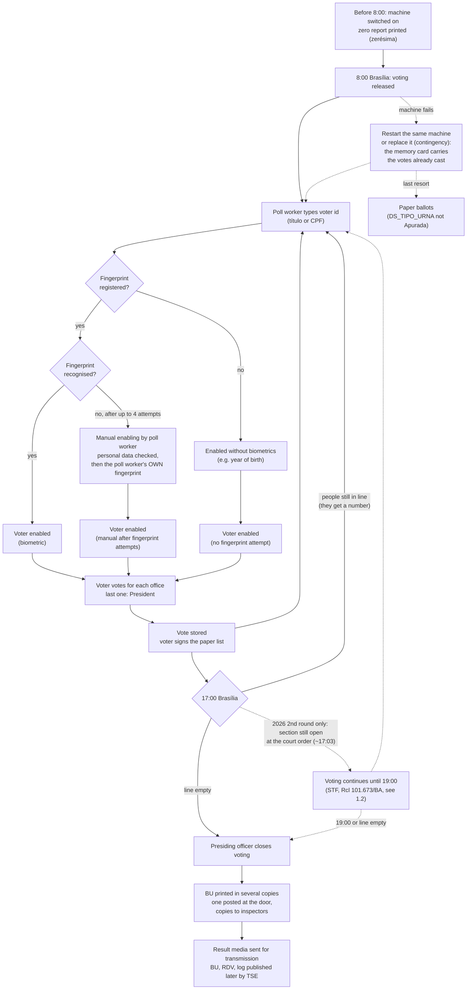

# Research Plan — Post-17:00 Voting and Ballot-Stuffing Signals in Brazilian Elections

> **Portuguese version: [RESEARCH_PLAN-pt-br.md](RESEARCH_PLAN-pt-br.md).** Both files carry the same content and
> must be updated together.

> Self-contained hand-off document: the claim, the questions, the verified data
> sources, the variables, every analysis step, and the checks. Nothing has been
> implemented yet.

**Scope decisions**
- **Geography:** all 27 states (Brasil inteiro).
- **Elections:** 2022 President, 1st and 2nd round (main dataset), and 2026 1st and 2nd round (replication). The 2026 2nd round (Oct 25, 2026) was published by TSE on Oct 26–27, 2026 and is loaded in the `_2t` raw tables.
- **Unit of analysis:** polling section × round.

---

## 1. Claim under test

A report from voters in Brazil's Northeast alleges a common practice: after the
polls close at 17:00, poll workers (*mesários*) already know which registered
voters did not show up and cast ballots in their names.

The goal is to **test** the claim with public data, not to prove it. If the
practice exists at scale, it should leave measurable traces in the voting-machine
logs and section results. If those traces are absent, that is also a valid
finding.

**Key constraint (vote secrecy):** no public file links an individual vote's
timestamp to the candidate chosen. The machine log has timestamps but no
candidate; the RDV has candidates but is shuffled. All candidate-level analysis
is therefore **ecological** (section level), never vote level.

### 1.1 How a polling section works, and what each step leaves in the data

The claim is about what happens inside a polling section, so the analysis has to
follow the section's own procedure. Each step below lists the **data trail** it
leaves. Log messages are quoted exactly as they appear in the 2026 `logd.dat`
files (application `VOTA` unless noted). Rules marked *(confirm)* come from
general knowledge of the procedure and still need to be checked against the TSE
resolution for 2026.

**Who is in the section**

| Role | What they do | Trace in public data |
|---|---|---|
| Presiding officer (*presidente da mesa*) | Opens and closes the voting, decides on incidents, signs the minutes | Operator actions in the log ("Operador selecionou: Encerrar votação") |
| Poll workers (*mesários*, *secretários*) | Identify voters, type the voter id into the poll-worker terminal, enable voters manually when the fingerprint fails, collect signatures on the voter list | Summons in `convocacao_mesarios` (aggregate only); in the log, "Mesário N habilitou o eleitor" and the poll-worker registration events (their voter ids are **not** stored by this project) |
| Party inspectors (*fiscais*) and delegates (*delegados*) | Watch opening, voting and closing; may file complaints in the minutes and ask for a printed copy of the BU | **None.** Their presence and the section minutes (*ata*) are not in the open data, so claims about "sections without inspectors" cannot be tested here |
| Electoral judge and technicians | Machine replacement (contingency), data recovery, ballot counting by the board when paper is used | Contingency and recovery events in the log; `DS_TIPO_URNA`, correspondence files (CESP/CEFT) |

**Flow of the day**



**Data trail of each step**

| Step | Log messages (2026) | Other files |
|---|---|---|
| Zero report and opening | "Gerando relatório [ZERÉSIMA] [INÍCIO]", "Urna pronta para receber votos" (local machine time: 06:00:01 in Acre is 8:00 in Brasília) | `DT_ABERTURA` in the BU (also local time) |
| Voter identification | "Aguardando digitação do identificador do eleitor", "Identificador do eleitor digitado pelo mesário", "Identificador digitado pelo mesário foi: (Título de eleitor)" or "(CPF)" | — |
| Biometric enabling | "Solicita digital. Tentativa [N] de [4]", "Capturada a digital. Tentativa [N] de [4]", "Tipo de habilitação do eleitor [biométrica]" | — |
| Manual enabling after failed fingerprints | Fingerprint attempts, then "Solicitação de dado pessoal do eleitor para habilitação manual", "Dado digitado confere", "Solicita digital do mesário" (the machine requires the poll worker's own fingerprint), "Mesário N habilitou o eleitor". Each manual enabling is therefore tied to a registered poll worker | `QT_ELEI_BIOM_SEM_HABILITACAO` in the BU (day total, not split by hour) |
| Enabling without any fingerprint attempt | "Ano de nascimento digitado é igual ao do cadastro" (or "… é diferente do cadastro") without prior "Capturada a digital" | — |
| Vote | "Eleitor foi habilitado", "Voto confirmado para [Governador]" (where there is a runoff), "Voto confirmado para [Presidente]", "O voto do eleitor foi computado" | RDV (shuffled votes), BU totals |
| Closing | "Operador selecionou: Encerrar votação", "Todas as pessoas presentes já votaram? SIM", "Gerando relatório [BU] [INÍCIO]", "Gerando arquivo de resultado [bu.dat] + [Início]" | `DT_ENCERRAMENTO` (local time), printed BU image (`imgbu.dat`) |
| Power loss / restart | Application `LOGD`: "Início das operações do logd", "Urna ligada em …"; the vote in progress may lack "computado" (see `tse.urna_logs`) | — |
| Contingency machine | "Modo de carga da UE - Urna de contingência", "Início do procedimento de contingência", "Término do processo de contingência", then the section's own "Município / Zona Eleitoral / Seção Eleitoral" | The original machine's log may be nested in the package (`…-01.jez`, `…ME.jez`); correspondence files |
| Data recovery | "Iniciando aplicação RECUPERADOR DE DADOS" (application `GAP`), then events of application `RED` | The package may carry the log of another section's machine (filtered by `tse.urna_logs.secoes_do_log`) |

**Rules to confirm in the 2026 TSE resolution** *(confirm)*
- Number of fingerprint attempts before manual enabling (the 2026 logs show up to "Tentativa [4] de [4]").
- Which personal data the poll worker must check for manual enabling, and whether a photo ID is mandatory.
- Procedure for voters in line at 17:00 (numbered tickets) and who may vote after 17:00.
- 2026 2nd round: who could vote between 17:00 and 19:00 in sections still open (any voter arriving, or numbered tickets only), per Ofício-Circular GAB-PRES nº 354/2026 (see §1.2).
- Number of BU copies printed and who is entitled to one.
- Integrity test (*teste de integridade*) sample and its published results.

**Where the claim under test sits in this flow.** A poll worker who knows from
the paper list which voters did not show up would have to type their voter id
after 17:00 and enable them manually (which requires a poll worker's own
fingerprint and is logged as "Mesário N habilitou o eleitor") or without
biometrics. That path leaves:
votes after 17:00 (`votes_after_17`), manual or no-fingerprint enabling
(`nh_rate_after`), no voting activity just before 17:00 (`gap_before_17`), and
votes closer together than a real voter can manage (`interval_after_17`). Those
are exactly the variables of RQ1–RQ3.

### 1.2 Exception in the 2026 2nd round: voting extended to 19:00

The flow above is the normal day. On the 2nd round of **25 October 2026** the
closing time was changed **during election day** by a court order, so in that
round a vote cast between 17:00 and 19:00 in a section that was still open was
**legal** and does not require a queue at 17:00. Every 17:00 cutoff in this plan
has to be read with that exception for 2026 2t (see §4, §6, §8).

**Who decided and how**

| Item | Fact |
|---|---|
| Decision | Preliminary injunction (*liminar*), single-judge (*monocrática*), extending the closing of vote reception "by two hours, until 19:00, Brasília time" |
| Judge | Minister **Cristiano Zanin**, Supreme Federal Court (**STF**) |
| Case | **Reclamação nº 101.673/BA** |
| Requested by | Coalition "Brasil Pronto Pra Mais" (Lula, PT). The campaign of Flávio Bolsonaro (PL) had also asked the TSE for an extension in municipalities of SP, PR, MG, RS and SC, citing rain and flooding |
| Legal ground | Alleged non-compliance by Salvador, Feira de Santana and Lauro de Freitas (BA) with **ADPF 1.013**, the STF ruling that requires free public transport, at weekday frequency, on election days |
| Scope | The complaint named 3 municipalities in Bahia; the order was extended to the whole country. Zanin later clarified it applied **only where machines had not yet been closed**; votes of machines already closed were totalised as usual. Closed machines were not reopened |
| Execution | The TSE president, Minister Kassio Nunes Marques, complied through Ofício-Circular GAB-PRES nº 354/2026: sections still open stayed open until 19:00. The TSE temporarily blocked the reception of BUs |
| Positions | The Electoral Public Prosecutor (MP Eleitoral) opposed the extension. Nunes Marques said the injunction, issued after closing time, "created difficulties for the electoral process" and that "never in the history of the TSE has there been any extension" |

**Timeline of the day (Brasília time, as reported by the press)**

| Time | Event |
|---|---|
| 13:22 and 15:42 | Lula's coalition files extension requests with the **TSE** |
| 16:22 | The coalition files the Reclamação with the **STF**, asking for nationwide effect |
| 16:33 | Case assigned to Minister Zanin |
| 17:00 | Legal closing time |
| ~17:03 | Zanin's decision is published |
| Later | Zanin clarifies: only machines not yet closed; TSE issues Ofício-Circular 354/2026 |
| 19:00 | New closing time for sections still open |

**Competence: STF × TSE.** Elections are run by the Electoral Justice, headed by
the **Superior Electoral Court (TSE)**. The order came from the **STF**, not from
the TSE. Both readings are recorded here, each with its source; this plan does not
decide between them:
- *Criticism:* the order "ran over the TSE", which was the body that should have
  decided the campaigns' requests (Poder360); the TSE president criticised the
  injunction and the MP Eleitoral opposed it.
- *Counter-argument:* a *reclamação* is the instrument to enforce the STF's own
  rulings, and the request was framed as non-compliance with ADPF 1.013, an STF
  ruling (Migalhas).

**About the judge (documented facts).** Cristiano Zanin was Luiz Inácio Lula da
Silva's personal defence lawyer in the Lava Jato criminal cases from 2013, and
obtained the annulment of Lula's convictions. Lula nominated him to the STF on
01/06/2023 (seat of Ricardo Lewandowski); the Senate approved him on 21/06/2023 by
58 votes to 18. The decision of 25/10/2026 granted a request from the coalition of
Lula, then a candidate for re-election. At his Senate hearing Zanin said he would
not judge cases in which he had acted as a lawyer.

**Challenges after the round (reported, not assessed here):** a request to the
Electoral Prosecutor General (PGE) to annul the 2nd round, a request for Zanin's
impeachment, and Flávio Bolsonaro's statement that he does not recognise the result.

**What this changes in the data.** Sections fall into two regimes in 2026 2t:
(a) closed before the decision (~17:03), where the normal 17:00 rule applies;
(b) still open at the decision, where voting could legally continue until 19:00.
The regime is inferred from the log (closing events) and `DT_ENCERRAMENTO`, not
from press reports (variables `extended_regime`, `closed_before_decision`,
`votes_17_19`, `votes_after_19` in §4). The other rounds (2022 1t/2t, 2026 1t)
keep the 17:00 rule, which turns 2026 2t into a natural comparison (§6, P7).

**Sources (press, used only as legal context; no analytical input comes from them).**
Poder360, 25/10/2026: https://www.poder360.com.br/poder-eleicoes-2026/zanin-prorroga-votacao-do-2o-turno-ate-19h/ ·
CNN Brasil, 25/10/2026: https://www.cnnbrasil.com.br/eleicoes/zanin-prorroga-eleicao-ate-as-19h-deste-domingo-em-todo-o-pais/ ·
Exame, 25/10/2026: https://exame.com/brasil/por-que-o-tse-decidiu-prorrogar-o-horario-de-votacao-ate-as-19h/ ·
Migalhas: https://www.migalhas.com.br/quentes/467195/zanin-prorroga-votacao-ate-as-19h-apos-reclamacao-sobre-transporte ·
Metrópoles: https://www.metropoles.com/brasil/nunes-marques-concorda-com-zanin-sobre-prorrogacao-da-votacao-ate-as-19h ·
CartaCapital: https://www.cartacapital.com.br/politica/em-pronunciamento-nunes-marques-critica-decisao-de-zanin-que-alterou-horario-de-votacao/ ·
Poder360, 01/06/2023: https://www.poder360.com.br/justica/lula-indica-seu-advogado-cristiano-zanin-ao-stf/ ·
Money Times, 21/06/2023: https://www.moneytimes.com.br/senado-aprova-indicacao-de-cristiano-zanin-ex-advogado-de-lula-para-o-stf/

*Pending:* attach the full text of the decision in Rcl 101.673/BA (STF portal) and
Ofício-Circular GAB-PRES nº 354/2026 (TSE). Where they contradict a time above,
the official documents prevail.

---

## 2. Research questions and hypotheses

**Main RQ:** In the Brazilian presidential election, do polling sections show
signs consistent with poll workers voting on behalf of absent voters after
17:00, and are those signs associated with turnout and candidate vote share?

| # | Sub-question | H₀ (null) |
|---|---|---|
| RQ1 | Is the share of voters enabled **without biometrics** higher after 17:00 than before, within the same section? | The no-biometric rate after 17:00 is not higher than before 17:00. |
| RQ2 | Do sections show post-17:00 voting **without a queue** at 17:00 (no activity in the last minutes before closing)? | Post-17:00 votes occur only in sections with continuous activity up to 17:00. |
| RQ3 | Do post-17:00 votes come in **bursts** (short, regular intervals between votes)? | Inter-vote intervals after 17:00 follow the same distribution as before 17:00 in the same section. |
| RQ4 | Are sections with high RQ1–RQ3 signals associated with **abnormally high turnout**? | Signal intensity is not associated with turnout, after municipal fixed effects. |
| RQ5 | Is post-17:00 activity associated with **candidate vote share**? | Post-17:00 share is not associated with candidate share, after municipal fixed effects. |

RQ1–RQ3 test the **mechanism**; RQ4–RQ5 test the **consequence**. A credible
signal needs both. An association in RQ5 alone is not evidence of fraud.

---

## 3. Data sources (verified on dadosabertos.tse.jus.br, Oct 2026)

All datasets can be listed through the portal's CKAN API, so no URL needs to be
hard-coded:

```
https://dadosabertos.tse.jus.br/api/3/action/package_search?q=2022
https://dadosabertos.tse.jus.br/api/3/action/package_show?id=<dataset-id>
```

### 3.1 Datasets

| Dataset id (CKAN) | Content | File pattern (cdn.tse.jus.br/estatistica/sead/…) | Size |
|---|---|---|---|
| `resultados-2022-boletim-de-urna`, `resultados-2026-boletim-de-urna` | Ballot report (BU) as CSV: one row per section × office × candidate | `eleicoes/eleicoes{Y}/buweb/bweb_{1t,2t}_{UF}_{timestamp}.zip` (+ `.sha512`) | Small (AC 1t 2022: 6 MB) |
| `resultados-2022-arquivos-transmitidos-para-totalizacao`, `resultados-2026-arquivos-transmitidos-para-totalizacao` | Raw machine files per section: `.bu`, `.imgbu`, **`.logjez`** (machine log, 7z-compressed), `.rdv`, `.vscmr` | `eleicoes/eleicoes{Y}/arqurnatot/bu_imgbu_logjez_rdv_vscmr_{Y}_{1t,2t}_{UF}.zip` | **Large:** 2022 2nd round AC 367 MB, PI 1.7 GB, SP 20 GB |
| `eleitorado-2022`, `eleitorado-2026` | Voter profile **per section** (age, education, etc.) | `odsele/perfil_eleitor_secao/perfil_eleitor_secao_{Y}_{UF}.zip` | Medium |
| `resultados-2022`, `resultados-2026` | Votes per section (`votacao_secao_{Y}_BR.zip`, 271 MB), turnout detail per section (`detalhe_votacao_secao_{Y}.zip`, 244 MB), **totalization timeline** (`Historico_Totalizacao_Presidente_BR_{1T,2T}_2022.zip`) | `odsele/votacao_secao/…`, `odsele/detalhe_votacao_secao/…`, `eleicoes/eleicoes2022/Historico_Totalizacao_…` | Medium |
| `resultados-2022-correspondencias-esperadas-e-efetivadas-{1,2}-turno`, `resultados-2026-correspondencias-esperadas-e-efetivadas-{1,2}-turno` | Expected vs. actual machine per section (machine replacements, contingency) | `eleicoes/eleicoes{Y}/correspesp/CESP_{t}_{UF}_*.zip` | Small |
| `comparecimento-e-abstencao-2022` | Turnout/abstention by voter profile | `odsele/perfil_comparecimento_abstencao/…` | Medium |
| `denuncias-eleitorais-2022`, `denuncias-eleitorais` (2026) | Complaints filed in the *Pardal* app: municipality, office, irregularity type, PJe case link | `odsele/denuncia/denuncia_{Y}.zip` | 1 MB |
| `mesarios-2022`, `mesarias-mesarios-e-funcoes-especiais-2026` | Poll-worker summons (aggregate use only) | `odsele/convocacao_mesarios/…` | Small |
| `correspondencia-entre-numero-interno-e-modelo-da-urna-1` | Voting-machine model per internal number | `odsele/modelo_urna/modelourna_numerointerno.zip` | Small |
| `resultados-2026-logs-do-sistema-de-preparacao-das-urnas-eletronicas-gedai-{1,2}-turno` | Logs of the machine-preparation system (context only) | — | — |

### 3.2 BU CSV columns (verified header, `bweb_1t_AC_*.csv`, `;`-separated, Latin-1)

```
DT_GERACAO; HH_GERACAO; ANO_ELEICAO; CD_TIPO_ELEICAO; NM_TIPO_ELEICAO; CD_PLEITO; DT_PLEITO;
NR_TURNO; CD_ELEICAO; DS_ELEICAO; SG_UF; CD_MUNICIPIO; NM_MUNICIPIO; NR_ZONA; NR_SECAO;
NR_LOCAL_VOTACAO; CD_CARGO_PERGUNTA; DS_CARGO_PERGUNTA; NR_PARTIDO; SG_PARTIDO; NM_PARTIDO;
DT_BU_RECEBIDO; QT_APTOS; QT_COMPARECIMENTO; QT_ABSTENCOES; CD_TIPO_URNA; DS_TIPO_URNA;
CD_TIPO_VOTAVEL; DS_TIPO_VOTAVEL; NR_VOTAVEL; NM_VOTAVEL; QT_VOTOS; NR_URNA_EFETIVADA;
CD_CARGA_1_URNA_EFETIVADA; CD_CARGA_2_URNA_EFETIVADA; CD_FLASHCARD_URNA_EFETIVADA;
DT_CARGA_URNA_EFETIVADA; DS_CARGO_PERGUNTA_SECAO; DS_AGREGADAS; DT_ABERTURA; DT_ENCERRAMENTO;
QT_ELEITORES_BIOMETRIA_NH; DT_EMISSAO_BU; NR_JUNTA_APURADORA; NR_TURMA_APURADORA
```

Columns that matter most:

| Column | Use |
|---|---|
| `DT_ABERTURA`, `DT_ENCERRAMENTO` | Machine opening/closing time; closing after 17:00 means voting continued after 17:00 |
| `QT_ELEITORES_BIOMETRIA_NH` | Voters **not enabled by biometrics** in the section (total for the day, not split by time) |
| `DT_BU_RECEBIDO` | When TSE received the BU, used for transmission delay (P8) |
| `QT_APTOS`, `QT_COMPARECIMENTO`, `QT_ABSTENCOES` | Registered voters, turnout, abstention |
| `DS_TIPO_URNA` | APURADA / replaced machine / etc. |
| `NR_URNA_EFETIVADA` | Machine id, mapped to model via `modelourna_numerointerno` |
| `DS_AGREGADAS` | Aggregated sections, which need special handling |
| `NR_VOTAVEL`, `QT_VOTOS` (with `DS_CARGO_PERGUNTA = Presidente`) | Candidate votes per section |

### 3.3 Two analysis tiers

| Tier | Data | What it answers | Cost |
|---|---|---|---|
| **Light** | BU CSV + voter profile, all of Brazil | Which sections closed after 17:00; overall no-biometric rate; turnout; candidate share; receipt delay (RQ4, RQ5, P8, partially RQ1) | Hundreds of MB, minutes |
| **Full** | Machine logs (`.logjez`), all of Brazil | Votes before/after 17:00, no-biometric **before vs. after** 17:00, queue gap, inter-vote intervals (RQ1–RQ3) | **Hundreds of GB** across 3 rounds, hours |

Do the light tier first: it is cheap and already answers part of the question.

### 3.4 Still unknown (resolve in the pilot, step 5.2)

- Exact log line format inside `.logjez` (expected: 7z archive containing `logd.dat`, one event per line with timestamp, level, machine id, application, message, hash).
- Exact log **message strings** for:
  - voter enabled by biometrics;
  - biometric failure, then enabled by the poll worker (typed voter ID / document);
  - vote computed;
  - machine closing.
- No official TSE documentation for the log messages was found. Build the event dictionary empirically from a small state, and cross-check against the 2022 analyses listed in §10.

---

## 4. Variables (section × round)

| Variable | Definition | Source | Tier |
|---|---|---|---|
| `uf`, `cd_municipio`, `nr_zona`, `nr_secao`, `nr_local_votacao` | Keys | BU | Light |
| `registered` | `QT_APTOS` | BU | Light |
| `turnout` | `QT_COMPARECIMENTO / QT_APTOS` | BU | Light |
| `close_time` | `DT_ENCERRAMENTO` | BU | Light |
| `closed_after_17` | `close_time > 17:00:00` (Brasília time) | Derived | Light |
| `minutes_after_17` | Minutes between 17:00 and `close_time` | Derived | Light |
| `nh_rate` | `QT_ELEITORES_BIOMETRIA_NH / QT_COMPARECIMENTO` | BU | Light |
| `cand_share_{x}` | Presidential vote share of each candidate (valid votes) | BU | Light |
| `receipt_delay` | `DT_BU_RECEBIDO − DT_ENCERRAMENTO` | BU | Light |
| `machine_model` | From `NR_URNA_EFETIVADA` | BU + model table | Light |
| `replaced_machine` | `DS_TIPO_URNA` ≠ APURADA, or the correspondence file shows a change | BU / CESP | Light |
| Age, education, biometric-registration share | Section voter profile | Profile | Light |
| `votes_before_17`, `votes_after_17` | Votes computed before/after 17:00:00 | Log | Full |
| `share_after_17` | `votes_after_17 / votes_total` | Derived | Full |
| `nh_rate_before`, `nh_rate_after` | No-biometric enablement rate before/after 17:00 | Log | Full |
| `gap_before_17` | Minutes between the last vote before 17:00 and 17:00 | Log | Full |
| `interval_after_17` (median, p10) | Seconds between consecutive votes after 17:00 | Log | Full |
| `burst_count` | Runs of ≥ N consecutive no-biometric votes with interval < S seconds | Log | Full |
| `last_vote_time` | Time of the last vote computed | Log | Full |
| `closed_before_decision` | 2026 2t only: section closed before the court order (~17:03 Brasília; exact time to be fixed from the official decision) | Log + BU | Full |
| `extended_regime` | 2026 2t only: section still open at the court order, so voting could legally continue until 19:00 (§1.2) | Log + BU | Full |
| `votes_17_19`, `votes_after_19` | 2026 2t only: votes computed between 17:00 and 19:00, and after 19:00 | Log | Full |
| `gap_before_19` | 2026 2t, `extended_regime` only: minutes between the last vote before 19:00 and 19:00 | Log | Full |

---

## 5. What has to be done (step by step)

### 5.1 Light tier: BU for all of Brazil
- [ ] List resources via the CKAN API for `resultados-{2022,2026}-boletim-de-urna` (27 UFs × 3 rounds = 81 files) and `eleitorado-{2022,2026}` (section profile).
- [ ] Download and verify against `.sha512` where published.
- [ ] Filter `DS_CARGO_PERGUNTA = Presidente`; collapse to **one row per section** with the variables in §4.
- [ ] Handle aggregated sections (`DS_AGREGADAS`) and replaced machines (`DS_TIPO_URNA`, CESP files).
- [ ] **Check:** national totals for the 2022 2nd round must match the official result (Lula 60,345,999; Bolsonaro 58,206,354). Section counts per UF must match `detalhe_votacao_secao`.

### 5.2 Log pilot (one small state)
- [ ] Download `bu_imgbu_logjez_rdv_vscmr_2022_2t_AC.zip` (367 MB).
- [ ] Open a few `.logjez` files (7z) and read the raw `logd.dat`.
- [ ] Build the **event dictionary** (§3.4): message string → category.
- [ ] Extract the per-section log features from §4.
- [ ] **Reconcile:** votes computed in the log must equal `QT_COMPARECIMENTO` in the BU. Target ≥ 99% match; list unmatched sections instead of dropping them.
- [ ] Review the dictionary and the match rate **before** scaling up.

### 5.3 Logs for all of Brazil
- [ ] Process **one state at a time** (download zip → read only `.logjez` → write per-section features → delete zip), so disk use stays near the size of the largest zip (SP ≈ 20 GB).
- [ ] Order: smallest states first, SP last; keep a progress/state file so the run can resume.
- [ ] Repeat for 2022 1t, 2022 2t and 2026 1t.

### 5.4 Build the panel
- [ ] Join BU + log features + voter profile on (`uf`, `cd_municipio`, `nr_zona`, `nr_secao`, round).
- [ ] Link 2022 1t ↔ 2t (same sections) and 2022 ↔ 2026, where section keys are stable.

---

## 6. Analysis points

### P0 — Data quality
- [ ] Log vs. BU reconciliation table (per UF and round).
- [ ] Flag and report: replaced machines, contingency votes, aggregated sections, transit voting, clock anomalies (events before opening or after closing).
- [ ] 2026 2t: flag any vote after 19:00, and any vote after 17:00 in a section with `closed_before_decision` (a closed machine could not be reopened).

### P1 — Descriptive picture (light tier)
- [ ] Distribution of `close_time` by UF/region; % of sections closing after 17:00, and how late.
- [ ] 2026 2t: split sections into `closed_before_decision` vs. `extended_regime`; distribution of `close_time` between 17:00 and 19:00 by UF/region.
- [ ] `nh_rate` by UF, region, age profile and machine model (the legitimate baseline).
- [ ] Turnout and candidate share by region.

### P2 — Mechanism: no-biometric enablement (RQ1, full tier)
- [ ] Paired comparison `nh_rate_after` vs `nh_rate_before` within each section (Wilcoxon signed-rank; effect size *r*).
- [ ] Repeat by region; test whether the Northeast differs **after controlling for** age, education and biometric registration.

### P3 — Mechanism: voting without a queue (RQ2, full tier)
Legitimate post-17:00 voting requires people already in line at 17:00, so there
should be continuous activity right before closing.
- [ ] Count sections with `votes_after_17 > 0` **and** `gap_before_17` > X minutes.
- [ ] Describe those sections: number of post-17:00 votes, how they were enabled, intervals.
- [ ] 2026 2t: in `extended_regime` sections, votes between 17:00 and 19:00 do not need a queue at 17:00; apply the queue test at 19:00 (`votes_after_19 > 0` and `gap_before_19` > X). Sections with `closed_before_decision` keep the 17:00 test.

### P4 — Mechanism: bursts (RQ3, full tier)
- [ ] Compare the interval distribution before vs. after 17:00 within each section (Kolmogorov–Smirnov or Mann–Whitney).
- [ ] Estimate the physical minimum time per vote (enable + all offices + confirm) from pre-17:00 data; flag intervals below it.
- [ ] Count runs of consecutive no-biometric votes (`burst_count`).

### P5 — Consequence: turnout (RQ4)
- [ ] **Election fingerprint** (Klimek et al., 2012): 2D histogram of turnout × candidate share per section, by region and round. Ballot stuffing shows up as a cluster near 100% turnout with high share for one candidate.
- [ ] Regression `turnout ~ signal + controls + municipality FE`, with errors clustered by municipality.

### P6 — Consequence: vote share (RQ5)
- [ ] Light tier: `cand_share ~ closed_after_17 + minutes_after_17 + nh_rate + controls + municipality FE`.
- [ ] Full tier: `cand_share ~ share_after_17 + nh_rate_after + controls + municipality FE`.
- [ ] **Within-section change between rounds (2022):** Δ`share_after_17` vs Δ`cand_share`; each section serves as its own control.

### P7 — Robustness and placebos
- [ ] **Placebo cutoffs:** repeat P2–P6 with 16:00 and 16:30 as the "closing" time. If the effect also appears there, it is not about closing.
- [ ] **2026 1st-round replication** with the same code and thresholds.
- [ ] **2026 2nd round as a natural comparison:** compare post-17:00 patterns (no-biometric rate, intervals, bursts) in 2026 2t `extended_regime` sections (legal 17:00–19:00 voting) with 2026 1t and 2022 (post-17:00 voting required a queue). Run the placebo cutoffs against both 17:00 and 19:00.
- [ ] Threshold sensitivity (X minutes, N votes, S seconds), with values fixed **before** looking at results.
- [ ] Optional 2018 baseline (closing was 17:00 *local* time, so the cutoff differs per state).

### P8 — Transmission delay (separate claim: "some states take too long to send results")
- [ ] `receipt_delay` by UF and municipality (light tier).
- [ ] Is the delay explained by remoteness (rural, Amazon region, satellite transmission) or associated with P2–P4 signals?
- [ ] Use `Historico_Totalizacao_Presidente_BR_{1T,2T}_2022` to show how the national count evolved over the night.

### P9 — Formal complaints (context)
- [ ] From the Pardal complaints (`denuncia_2022`, `denuncia_2026`): count complaints by irregularity type and municipality, and check whether this practice was formally reported, and where.
- [ ] Compare complaint municipalities with flagged vs. non-flagged sections (aggregate only).

---

## 7. Alternative explanations to rule out

| Observed pattern | Innocent explanation | How to control |
|---|---|---|
| Many votes after 17:00 | Queue at closing time | `gap_before_17` (P3) |
| Votes between 17:00 and 19:00 in 2026 2t | Court-ordered extension (Rcl 101.673/BA, §1.2) | `extended_regime`, `votes_17_19` |
| More no-biometric enablement | Worn fingerprints (manual workers), elderly voters, faulty readers | Age/education profile, machine model, biometric-registration share |
| Regional pattern correlated with a candidate | Northeast has a different political preference **and** different demographics | Municipal fixed effects, within-section changes |
| Very early "closing" in the West | Unified Brasília time (closes 15:00 local time in Acre) | Use Brasília time consistently |
| Late results | Logistics (remote areas, satellite) | P8 |
| Odd log timestamps | Machine clock errors, replaced machines | P0 flags |

---

## 8. Interpretation rule (fix before running)

A section counts as an **anomaly** only if it meets all three conditions:
1. post-17:00 votes with no activity in the X minutes before 17:00;
2. post-17:00 votes mostly enabled without biometrics;
3. intervals below the physical minimum, or in bursts.

Report: number and % of anomalous sections, their geographic distribution, their
turnout and vote share compared with other sections in the same municipality, and
**the maximum number of votes that could have been affected**. Compare that number
with the national margin of victory.

Write down X, N and S (and the reasoning) **before** computing the anomaly table.

**2026 2nd round:** for `extended_regime` sections, read "17:00" in conditions 1–2 as
19:00 (votes between 17:00 and 19:00 were legal). For `closed_before_decision`
sections the 17:00 rule stays.

---

## 9. Limitations and ethics

- Ecological inference: section-level associations do not reveal individual votes.
- An anomaly is an **indication**, not proof; only an audit or investigation can confirm it.
- Log clock and event-format issues may create false signals (P0).
- Do not name poll workers or accuse specific sections publicly; report aggregates.
- Data is public; use nothing beyond what TSE publishes.
- Threat model of the whole electoral chain (where fraud could happen, existing controls, residual risk, what TSE data can detect, and international cases): [docs/modelo_de_ameacas.md](docs/modelo_de_ameacas.md) (Portuguese).

---

## 10. Prior work to read

- Klimek, P., Yegorov, Y., Hanel, R., & Thurner, S. (2012). Statistical detection of systematic election irregularities. *PNAS, 109*(41), 16469–16473.
- Mebane, W. R. — *Election Forensics* (turnout- and digit-based tests, and their limits).
- Partido Liberal / Instituto Voto Legal (2022). *Relatório Técnico — Logs Inválidos das Urnas Eletrônicas* (v0.7, 15/11/2022), plus the TSE response.
- Independent analysis by USP/UFSCar/UFPA and other researchers of the log issue (Poder360, Dec 2022): https://static.poder360.com.br/2022/12/Analise-Bug04030201_USPUFSCarUFPAoutros.pdf
- Virgolino, V. A. C. (2023). *UrnaLogs* — undergraduate thesis, UFCG (collection and organization of the 2022 logs by section): https://bdtd.ufcg.edu.br/jspui/bitstream/riufcg/30487/1/VICTOR%20ARRUDA%20C%c3%82MARA%20VIRGOLINO%20-%20TCC%20ARTIGO%20CI%c3%8aNCIA%20DA%20COMPUTA%c3%87%c3%83O%20CEEI%202023.pdf
- Fact-checks on "votes after 17:00" and on the logs (Comprova/Metrópoles, O Popular, 2022). List every argument they raise and make sure the analysis addresses it.
- TSE IT glossary (biometric verification vs. identification): https://www.tse.jus.br/institucional/catalogo-de-publicacoes/arquivos/glossario-ti
- STF, Reclamação nº 101.673/BA (Min. Cristiano Zanin, 25/10/2026), STF ADPF 1.013 (free transport on election day) and TSE Ofício-Circular GAB-PRES nº 354/2026: official texts to attach. Press coverage used for §1.2 is listed there.

---

## 11. Expected deliverables

1. Section-level panel (2022 1t, 2022 2t, 2026 1t, all UFs) with the §4 variables.
2. Log event dictionary and reconciliation report (P0).
3. Descriptive report and figures (P1, fingerprints, close-time maps).
4. Hypothesis tests RQ1–RQ5 with effect sizes, placebo results and the 2026 replication.
5. Anomaly table (aggregate), with the maximum affected votes compared to the margin.
6. Written conclusion: whether the evidence supports the claim, and its limitations.
