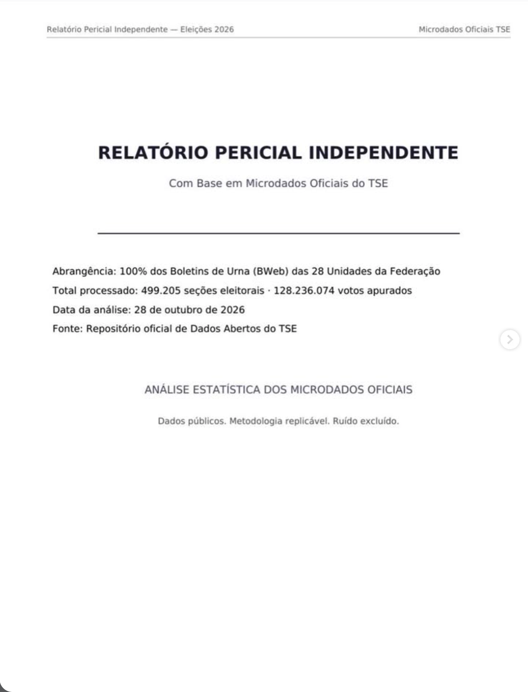

# Página 1 — Capa

> Transcrição fiel do documento de terceiros. Cabeçalho da página: "Relatório Pericial Independente — Eleições 2026" · "Microdados Oficiais TSE".

---

# RELATÓRIO PERICIAL INDEPENDENTE

Com Base em Microdados Oficiais do TSE

---

- **Abrangência:** 100% dos Boletins de Urna (BWeb) das 28 Unidades da Federação
- **Total processado:** 499.205 seções eleitorais · 128.236.074 votos apurados
- **Data da análise:** 28 de outubro de 2026
- **Fonte:** Repositório oficial de Dados Abertos do TSE

**ANÁLISE ESTATÍSTICA DOS MICRODADOS OFICIAIS**

Dados públicos. Metodologia replicável. Ruído excluído.
