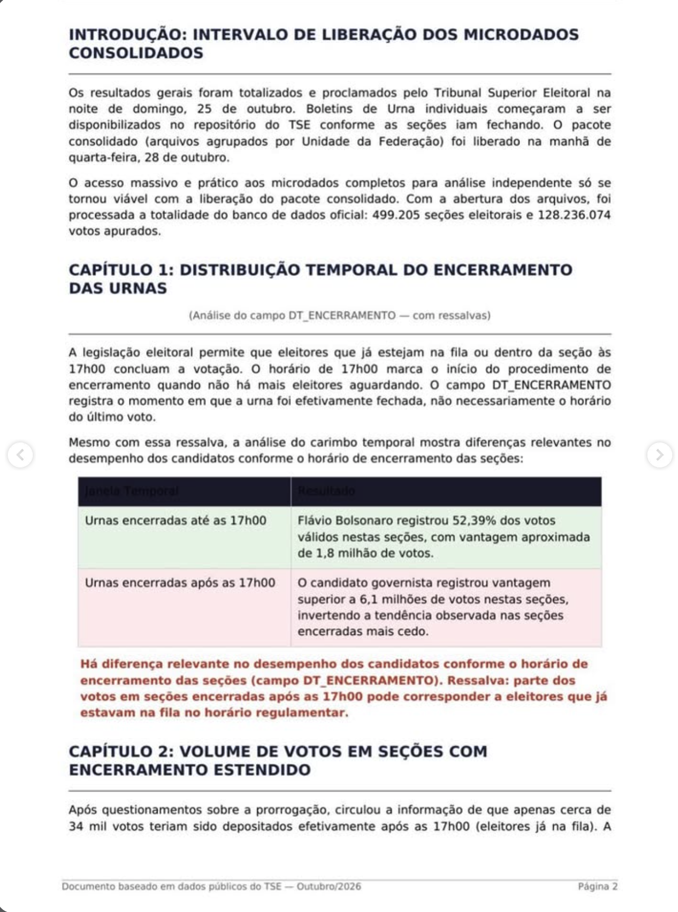

# Página 2 — Introdução, Capítulo 1 e início do Capítulo 2

> Transcrição fiel do documento de terceiros. Rodapé: "Documento baseado em dados públicos do TSE — Outubro/2026 · Página 2".

---

## INTRODUÇÃO: INTERVALO DE LIBERAÇÃO DOS MICRODADOS CONSOLIDADOS

Os resultados gerais foram totalizados e proclamados pelo Tribunal Superior Eleitoral na noite de domingo, 25 de outubro. Boletins de Urna individuais começaram a ser disponibilizados no repositório do TSE conforme as seções iam fechando. O pacote consolidado (arquivos agrupados por Unidade da Federação) foi liberado na manhã de quarta-feira, 28 de outubro.

O acesso massivo e prático aos microdados completos para análise independente só se tornou viável com a liberação do pacote consolidado. Com a abertura dos arquivos, foi processada a totalidade do banco de dados oficial: 499.205 seções eleitorais e 128.236.074 votos apurados.

## CAPÍTULO 1: DISTRIBUIÇÃO TEMPORAL DO ENCERRAMENTO DAS URNAS

*(Análise do campo DT_ENCERRAMENTO — com ressalvas)*

A legislação eleitoral permite que eleitores que já estejam na fila ou dentro da seção às 17h00 concluam a votação. O horário de 17h00 marca o início do procedimento de encerramento quando não há mais eleitores aguardando. O campo DT_ENCERRAMENTO registra o momento em que a urna foi efetivamente fechada, não necessariamente o horário do último voto.

Mesmo com essa ressalva, a análise do carimbo temporal mostra diferenças relevantes no desempenho dos candidatos conforme o horário de encerramento das seções:

| Janela Temporal | Resultado |
|---|---|
| Urnas encerradas até as 17h00 | Flávio Bolsonaro registrou 52,39% dos votos válidos nestas seções, com vantagem aproximada de 1,8 milhão de votos. |
| Urnas encerradas após as 17h00 | O candidato governista registrou vantagem superior a 6,1 milhões de votos nestas seções, invertendo a tendência observada nas seções encerradas mais cedo. |

**Há diferença relevante no desempenho dos candidatos conforme o horário de encerramento das seções (campo DT_ENCERRAMENTO). Ressalva: parte dos votos em seções encerradas após as 17h00 pode corresponder a eleitores que já estavam na fila no horário regulamentar.**

## CAPÍTULO 2: VOLUME DE VOTOS EM SEÇÕES COM ENCERRAMENTO ESTENDIDO

Após questionamentos sobre a prorrogação, circulou a informação de que apenas cerca de 34 mil votos teriam sido depositados efetivamente após as 17h00 (eleitores já na fila). A *(continua na página 3)*
