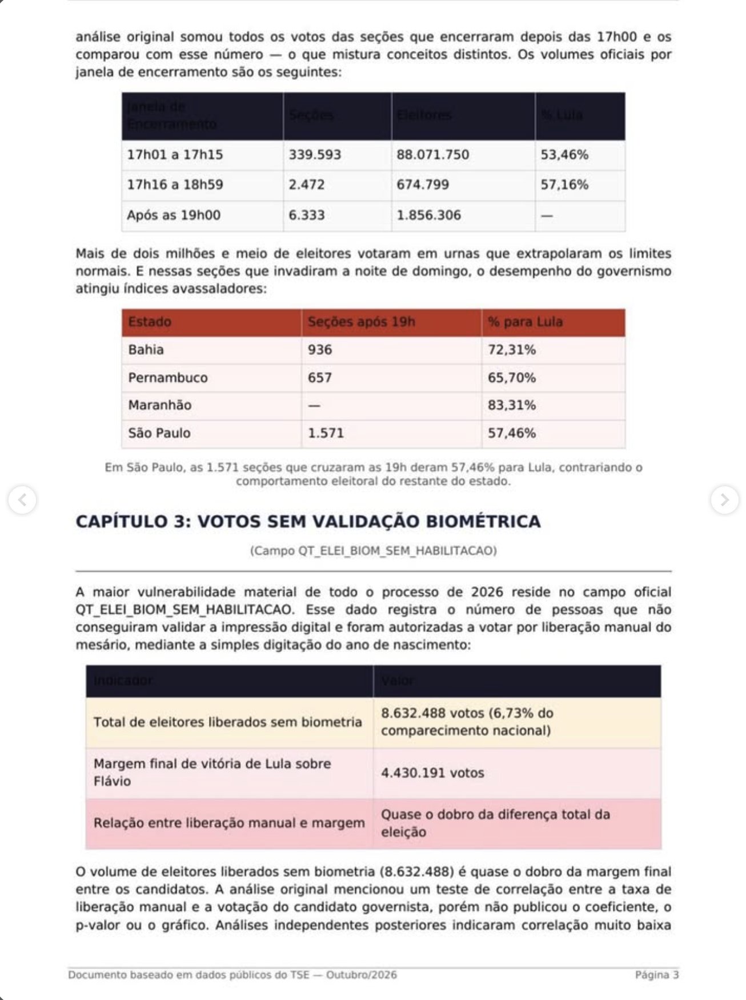

# Página 3 — Continuação do Capítulo 2 e Capítulo 3

> Transcrição fiel do documento de terceiros. Rodapé: "Documento baseado em dados públicos do TSE — Outubro/2026 · Página 3".

---

*(continuação do Capítulo 2)* análise original somou todos os votos das seções que encerraram depois das 17h00 e os comparou com esse número — o que mistura conceitos distintos. Os volumes oficiais por janela de encerramento são os seguintes:

| Janela de Encerramento | Seções | Eleitores | % Lula |
|---|---|---|---|
| 17h01 a 17h15 | 339.593 | 88.071.750 | 53,46% |
| 17h16 a 18h59 | 2.472 | 674.799 | 57,16% |
| Após as 19h00 | 6.333 | 1.856.306 | — |

Mais de dois milhões e meio de eleitores votaram em urnas que extrapolaram os limites normais. E nessas seções que invadiram a noite de domingo, o desempenho do governismo atingiu índices avassaladores:

| Estado | Seções após 19h | % para Lula |
|---|---|---|
| Bahia | 936 | 72,31% |
| Pernambuco | 657 | 65,70% |
| Maranhão | — | 83,31% |
| São Paulo | 1.571 | 57,46% |

*Em São Paulo, as 1.571 seções que cruzaram as 19h deram 57,46% para Lula, contrariando o comportamento eleitoral do restante do estado.*

## CAPÍTULO 3: VOTOS SEM VALIDAÇÃO BIOMÉTRICA

*(Campo QT_ELEI_BIOM_SEM_HABILITACAO)*

A maior vulnerabilidade material de todo o processo de 2026 reside no campo oficial QT_ELEI_BIOM_SEM_HABILITACAO. Esse dado registra o número de pessoas que não conseguiram validar a impressão digital e foram autorizadas a votar por liberação manual do mesário, mediante a simples digitação do ano de nascimento:

| Indicador | Valor |
|---|---|
| Total de eleitores liberados sem biometria | 8.632.488 votos (6,73% do comparecimento nacional) |
| Margem final de vitória de Lula sobre Flávio | 4.430.191 votos |
| Relação entre liberação manual e margem | Quase o dobro da diferença total da eleição |

O volume de eleitores liberados sem biometria (8.632.488) é quase o dobro da margem final entre os candidatos. A análise original mencionou um teste de correlação entre a taxa de liberação manual e a votação do candidato governista, porém não publicou o coeficiente, o p-valor ou o gráfico. Análises independentes posteriores indicaram correlação muito baixa *(continua na página 4)*
