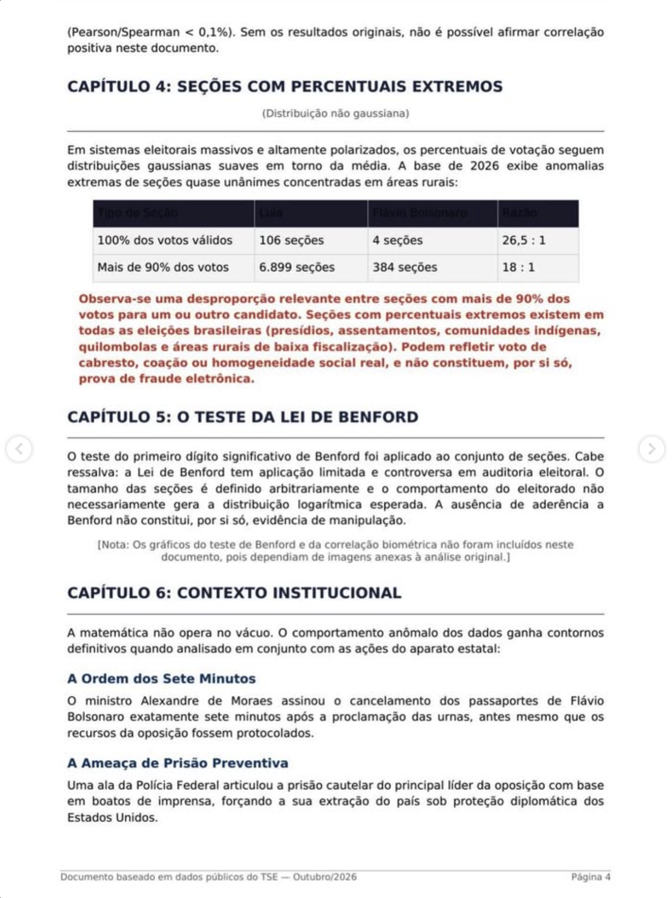

# Página 4 — Fim do Capítulo 3, Capítulos 4, 5 e início do 6

> Transcrição fiel do documento de terceiros. Rodapé: "Documento baseado em dados públicos do TSE — Outubro/2026 · Página 4".

---

*(continuação do Capítulo 3)* (Pearson/Spearman < 0,1%). Sem os resultados originais, não é possível afirmar correlação positiva neste documento.

## CAPÍTULO 4: SEÇÕES COM PERCENTUAIS EXTREMOS

*(Distribuição não gaussiana)*

Em sistemas eleitorais massivos e altamente polarizados, os percentuais de votação seguem distribuições gaussianas suaves em torno da média. A base de 2026 exibe anomalias extremas de seções quase unânimes concentradas em áreas rurais:

| Tipo de Seção | Lula | Flávio Bolsonaro | Razão |
|---|---|---|---|
| 100% dos votos válidos | 106 seções | 4 seções | 26,5 : 1 |
| Mais de 90% dos votos | 6.899 seções | 384 seções | 18 : 1 |

**Observa-se uma desproporção relevante entre seções com mais de 90% dos votos para um ou outro candidato. Seções com percentuais extremos existem em todas as eleições brasileiras (presídios, assentamentos, comunidades indígenas, quilombolas e áreas rurais de baixa fiscalização). Podem refletir voto de cabresto, coação ou homogeneidade social real, e não constituem, por si só, prova de fraude eletrônica.**

## CAPÍTULO 5: O TESTE DA LEI DE BENFORD

O teste do primeiro dígito significativo de Benford foi aplicado ao conjunto de seções. Cabe ressalva: a Lei de Benford tem aplicação limitada e controversa em auditoria eleitoral. O tamanho das seções é definido arbitrariamente e o comportamento do eleitorado não necessariamente gera a distribuição logarítmica esperada. A ausência de aderência a Benford não constitui, por si só, evidência de manipulação.

*[Nota: Os gráficos do teste de Benford e da correlação biométrica não foram incluídos neste documento, pois dependiam de imagens anexas à análise original.]*

## CAPÍTULO 6: CONTEXTO INSTITUCIONAL

A matemática não opera no vácuo. O comportamento anômalo dos dados ganha contornos definitivos quando analisado em conjunto com as ações do aparato estatal:

### A Ordem dos Sete Minutos

O ministro Alexandre de Moraes assinou o cancelamento dos passaportes de Flávio Bolsonaro exatamente sete minutos após a proclamação das urnas, antes mesmo que os recursos da oposição fossem protocolados.

### A Ameaça de Prisão Preventiva

Uma ala da Polícia Federal articulou a prisão cautelar do principal líder da oposição com base em boatos de imprensa, forçando a sua extração do país sob proteção diplomática dos Estados Unidos.
