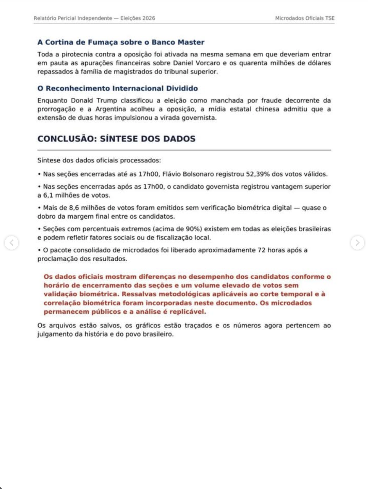

# Página 5 — Fim do Capítulo 6 e Conclusão

> Transcrição fiel do documento de terceiros. Cabeçalho: "Relatório Pericial Independente — Eleições 2026" · "Microdados Oficiais TSE". A página não traz número no rodapé; pela sequência, é a página 5.

---

### A Cortina de Fumaça sobre o Banco Master

Toda a pirotecnia contra a oposição foi ativada na mesma semana em que deveriam entrar em pauta as apurações financeiras sobre Daniel Vorcaro e os quarenta milhões de dólares repassados à família de magistrados do tribunal superior.

### O Reconhecimento Internacional Dividido

Enquanto Donald Trump classificou a eleição como manchada por fraude decorrente da prorrogação e a Argentina acolheu a oposição, a mídia estatal chinesa admitiu que a extensão de duas horas impulsionou a virada governista.

## CONCLUSÃO: SÍNTESE DOS DADOS

Síntese dos dados oficiais processados:

- Nas seções encerradas até as 17h00, Flávio Bolsonaro registrou 52,39% dos votos válidos.
- Nas seções encerradas após as 17h00, o candidato governista registrou vantagem superior a 6,1 milhões de votos.
- Mais de 8,6 milhões de votos foram emitidos sem verificação biométrica digital — quase o dobro da margem final entre os candidatos.
- Seções com percentuais extremos (acima de 90%) existem em todas as eleições brasileiras e podem refletir fatores sociais ou de fiscalização local.
- O pacote consolidado de microdados foi liberado aproximadamente 72 horas após a proclamação dos resultados.

**Os dados oficiais mostram diferenças no desempenho dos candidatos conforme o horário de encerramento das seções e um volume elevado de votos sem validação biométrica. Ressalvas metodológicas aplicáveis ao corte temporal e à correlação biométrica foram incorporadas neste documento. Os microdados permanecem públicos e a análise é replicável.**

Os arquivos estão salvos, os gráficos estão traçados e os números agora pertencem ao julgamento da história e do povo brasileiro.
