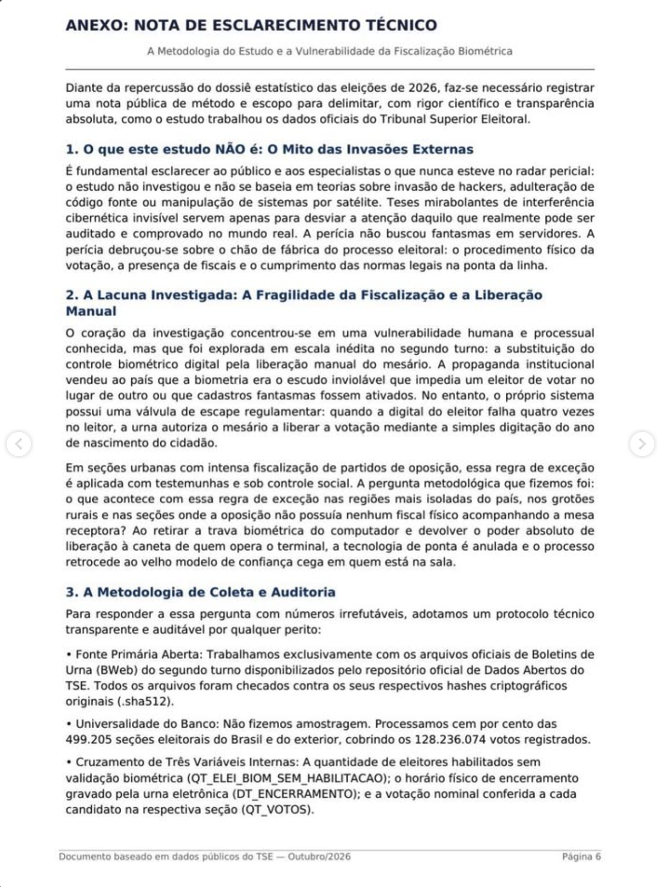

# Página 6 — Anexo: Nota de Esclarecimento Técnico (itens 1 a 3)

> Transcrição fiel do documento de terceiros. Rodapé: "Documento baseado em dados públicos do TSE — Outubro/2026 · Página 6".

---

## ANEXO: NOTA DE ESCLARECIMENTO TÉCNICO

*A Metodologia do Estudo e a Vulnerabilidade da Fiscalização Biométrica*

Diante da repercussão do dossiê estatístico das eleições de 2026, faz-se necessário registrar uma nota pública de método e escopo para delimitar, com rigor científico e transparência absoluta, como o estudo trabalhou os dados oficiais do Tribunal Superior Eleitoral.

### 1. O que este estudo NÃO é: O Mito das Invasões Externas

É fundamental esclarecer ao público e aos especialistas o que nunca esteve no radar pericial: o estudo não investigou e não se baseia em teorias sobre invasão de hackers, adulteração de código fonte ou manipulação de sistemas por satélite. Teses mirabolantes de interferência cibernética invisível servem apenas para desviar a atenção daquilo que realmente pode ser auditado e comprovado no mundo real. A perícia não buscou fantasmas em servidores. A perícia debruçou-se sobre o chão de fábrica do processo eleitoral: o procedimento físico da votação, a presença de fiscais e o cumprimento das normas legais na ponta da linha.

### 2. A Lacuna Investigada: A Fragilidade da Fiscalização e a Liberação Manual

O coração da investigação concentrou-se em uma vulnerabilidade humana e processual conhecida, mas que foi explorada em escala inédita no segundo turno: a substituição do controle biométrico digital pela liberação manual do mesário. A propaganda institucional vendeu ao país que a biometria era o escudo inviolável que impedia um eleitor de votar no lugar de outro ou que cadastros fantasmas fossem ativados. No entanto, o próprio sistema possui uma válvula de escape regulamentar: quando a digital do eleitor falha quatro vezes no leitor, a urna autoriza o mesário a liberar a votação mediante a simples digitação do ano de nascimento do cidadão.

Em seções urbanas com intensa fiscalização de partidos de oposição, essa regra de exceção é aplicada com testemunhas e sob controle social. A pergunta metodológica que fizemos foi: o que acontece com essa regra de exceção nas regiões mais isoladas do país, nos grotões rurais e nas seções onde a oposição não possuía nenhum fiscal físico acompanhando a mesa receptora? Ao retirar a trava biométrica do computador e devolver o poder absoluto de liberação à caneta de quem opera o terminal, a tecnologia de ponta é anulada e o processo retrocede ao velho modelo de confiança cega em quem está na sala.

### 3. A Metodologia de Coleta e Auditoria

Para responder a essa pergunta com números irrefutáveis, adotamos um protocolo técnico transparente e auditável por qualquer perito:

- **Fonte Primária Aberta:** Trabalhamos exclusivamente com os arquivos oficiais de Boletins de Urna (BWeb) do segundo turno disponibilizados pelo repositório oficial de Dados Abertos do TSE. Todos os arquivos foram checados contra os seus respectivos hashes criptográficos originais (.sha512).
- **Universalidade do Banco:** Não fizemos amostragem. Processamos cem por cento das 499.205 seções eleitorais do Brasil e do exterior, cobrindo os 128.236.074 votos registrados.
- **Cruzamento de Três Variáveis Internas:** A quantidade de eleitores habilitados sem validação biométrica (QT_ELEI_BIOM_SEM_HABILITACAO); o horário físico de encerramento gravado pela urna eletrônica (DT_ENCERRAMENTO); e a votação nominal conferida a cada candidato na respectiva seção (QT_VOTOS).
