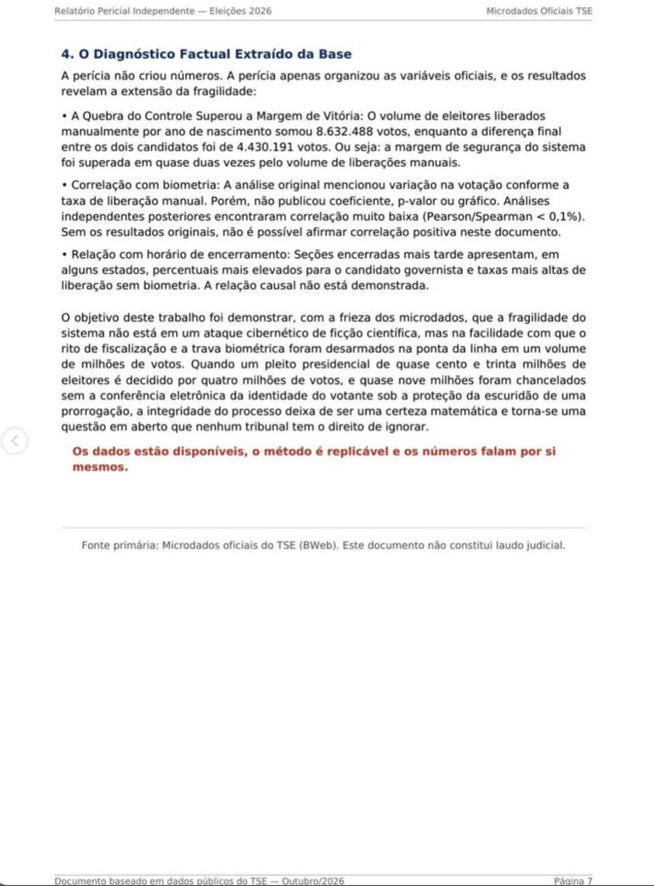

# Página 7 — Anexo: Diagnóstico Factual (item 4) e encerramento

> Transcrição fiel do documento de terceiros. Cabeçalho: "Relatório Pericial Independente — Eleições 2026" · "Microdados Oficiais TSE". Rodapé: "Documento baseado em dados públicos do TSE — Outubro/2026 · Página 7".

---

### 4. O Diagnóstico Factual Extraído da Base

A perícia não criou números. A perícia apenas organizou as variáveis oficiais, e os resultados revelam a extensão da fragilidade:

- **A Quebra do Controle Superou a Margem de Vitória:** O volume de eleitores liberados manualmente por ano de nascimento somou 8.632.488 votos, enquanto a diferença final entre os dois candidatos foi de 4.430.191 votos. Ou seja: a margem de segurança do sistema foi superada em quase duas vezes pelo volume de liberações manuais.
- **Correlação com biometria:** A análise original mencionou variação na votação conforme a taxa de liberação manual. Porém, não publicou coeficiente, p-valor ou gráfico. Análises independentes posteriores encontraram correlação muito baixa (Pearson/Spearman < 0,1%). Sem os resultados originais, não é possível afirmar correlação positiva neste documento.
- **Relação com horário de encerramento:** Seções encerradas mais tarde apresentam, em alguns estados, percentuais mais elevados para o candidato governista e taxas mais altas de liberação sem biometria. A relação causal não está demonstrada.

O objetivo deste trabalho foi demonstrar, com a frieza dos microdados, que a fragilidade do sistema não está em um ataque cibernético de ficção científica, mas na facilidade com que o rito de fiscalização e a trava biométrica foram desarmados na ponta da linha em um volume de milhões de votos. Quando um pleito presidencial de quase cento e trinta milhões de eleitores é decidido por quatro milhões de votos, e quase nove milhões foram chancelados sem a conferência eletrônica da identidade do votante sob a proteção da escuridão de uma prorrogação, a integridade do processo deixa de ser uma certeza matemática e torna-se uma questão em aberto que nenhum tribunal tem o direito de ignorar.

**Os dados estão disponíveis, o método é replicável e os números falam por si mesmos.**

---

*Fonte primária: Microdados oficiais do TSE (BWeb). Este documento não constitui laudo judicial.*
