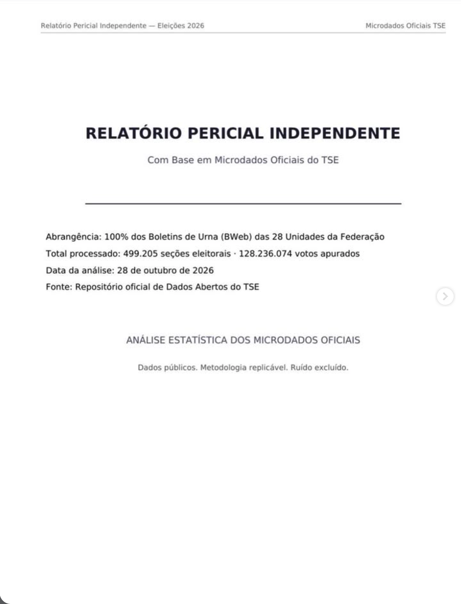
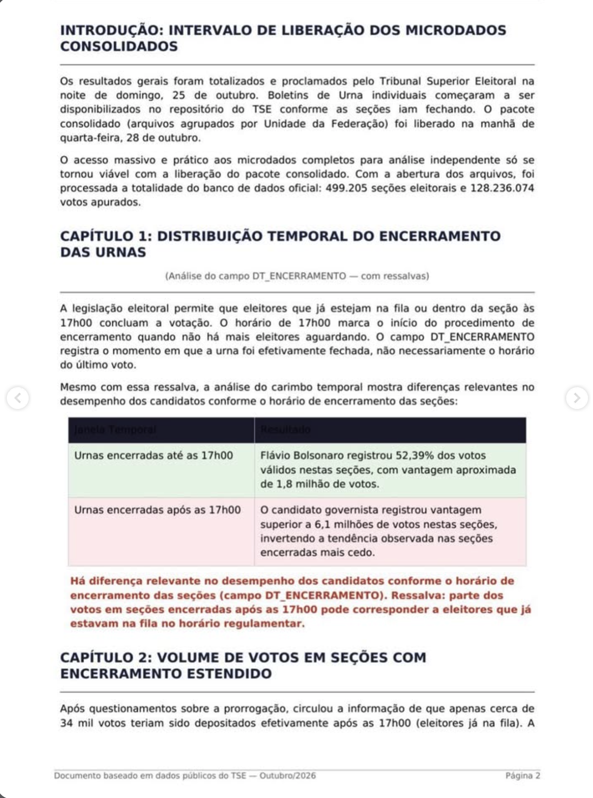
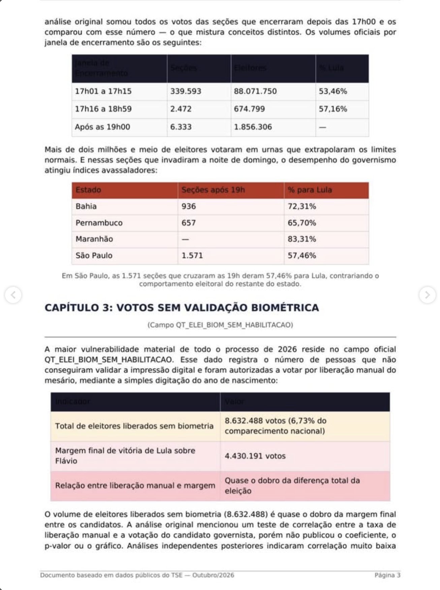
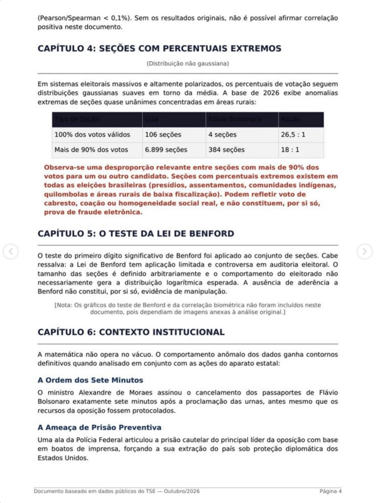
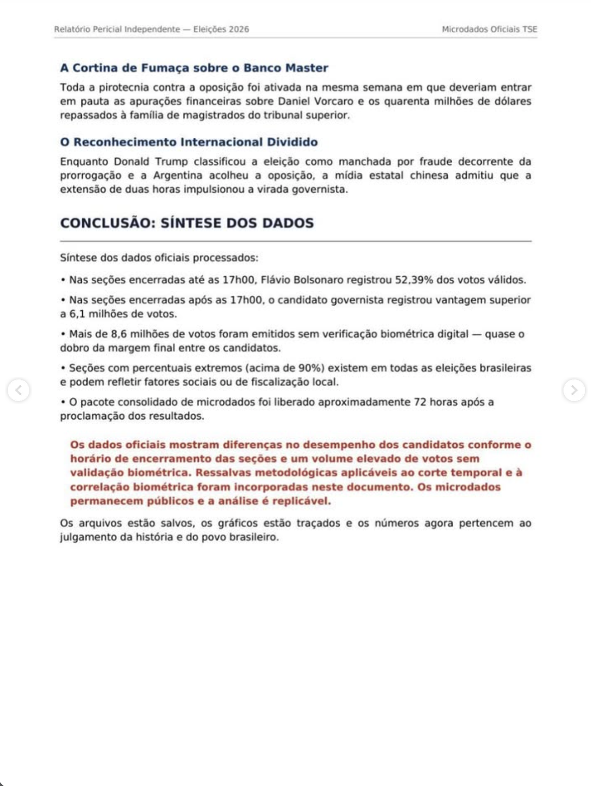
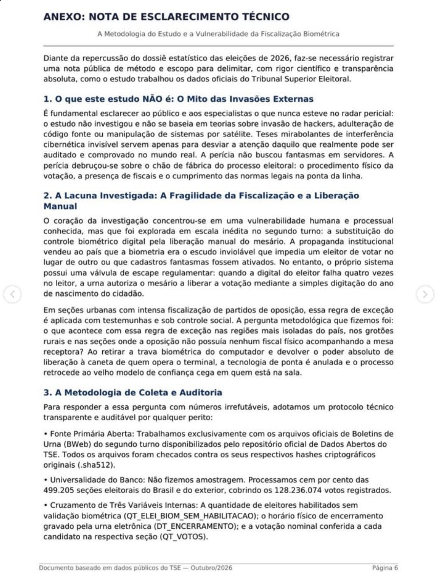
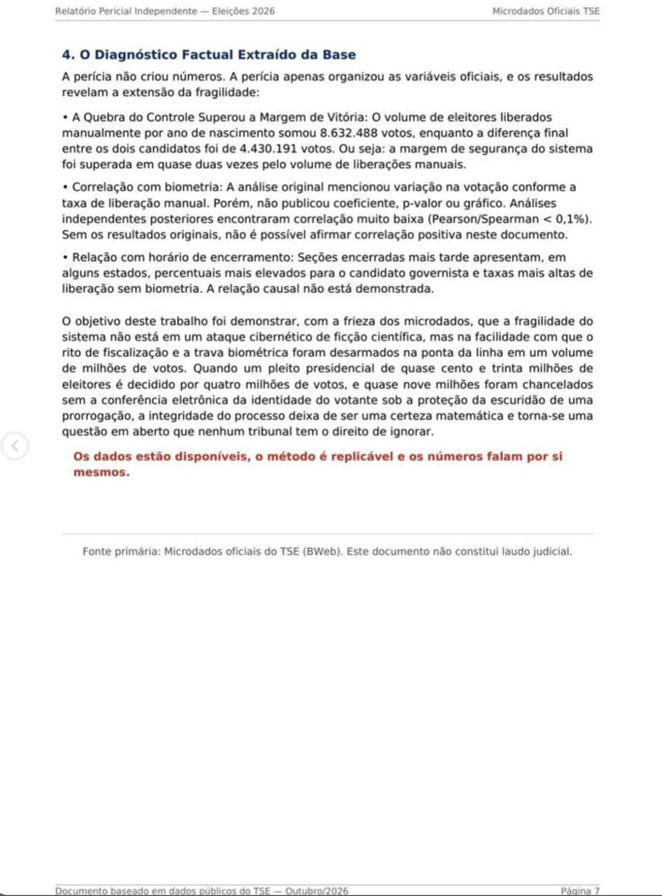

# Relatório Pericial Independente — Eleições 2026 (transcrição integral)

> **O que é este arquivo.** Transcrição fiel, página por página, de um documento de terceiros intitulado
> "Relatório Pericial Independente — Com Base em Microdados Oficiais do TSE" (7 páginas, datado de 28/10/2026),
> recebido como imagens. O texto foi transcrito sem alterações; as imagens originais estão ao lado de cada página.
> O documento **não** foi produzido por este projeto, e suas afirmações não são endossadas aqui.
> As notas de verificação abaixo são do projeto Auditoria-Eleicao-2026 e ficam separadas da transcrição.

## Páginas

| Página | Conteúdo | Imagem | Transcrição |
|---|---|---|---|
| 1 | Capa | [pagina-01-capa.png](pagina-01-capa.png) | [pagina-01-capa.md](pagina-01-capa.md) |
| 2 | Introdução; Cap. 1 (encerramento das urnas); início do Cap. 2 | [pagina-02-introducao-e-capitulos-1-2.png](pagina-02-introducao-e-capitulos-1-2.png) | [pagina-02-introducao-e-capitulos-1-2.md](pagina-02-introducao-e-capitulos-1-2.md) |
| 3 | Cap. 2 (encerramento estendido); Cap. 3 (votos sem biometria) | [pagina-03-capitulos-2-3.png](pagina-03-capitulos-2-3.png) | [pagina-03-capitulos-2-3.md](pagina-03-capitulos-2-3.md) |
| 4 | Fim do Cap. 3; Cap. 4 (percentuais extremos); Cap. 5 (Benford); início do Cap. 6 | [pagina-04-capitulos-3-a-6.png](pagina-04-capitulos-3-a-6.png) | [pagina-04-capitulos-3-a-6.md](pagina-04-capitulos-3-a-6.md) |
| 5 | Fim do Cap. 6 (contexto institucional); Conclusão | [pagina-05-capitulo-6-e-conclusao.png](pagina-05-capitulo-6-e-conclusao.png) | [pagina-05-capitulo-6-e-conclusao.md](pagina-05-capitulo-6-e-conclusao.md) |
| 6 | Anexo: nota de esclarecimento técnico (itens 1–3) | [pagina-06-anexo-nota-tecnica.png](pagina-06-anexo-nota-tecnica.png) | [pagina-06-anexo-nota-tecnica.md](pagina-06-anexo-nota-tecnica.md) |
| 7 | Anexo: diagnóstico factual (item 4) e encerramento | [pagina-07-anexo-diagnostico.png](pagina-07-anexo-diagnostico.png) | [pagina-07-anexo-diagnostico.md](pagina-07-anexo-diagnostico.md) |

## Notas de verificação (projeto Auditoria-Eleicao-2026)

Conferência feita em 29/10/2026 com o Boletim de Urna do 2º turno (`bweb_2t_*`, 28 UFs, SHA-512 conferido com o
`.sha512` oficial) já validado contra a API de Resultados assinada do TSE. Somente dados oficiais do TSE.

**Números que se reproduzem exatamente**

| Afirmação do documento | Valor nos dados oficiais |
|---|---|
| 499.205 seções; 128.236.074 votos | 499.205 seções; comparecimento 128.236.074 |
| 8.632.488 eleitores sem biometria (6,73%) | soma de `QT_ELEI_BIOM_SEM_HABILITACAO` = 8.632.488 (6,73%) |
| Margem de 4.430.191 votos | Lula 64.256.232 − Flávio 59.826.041 = 4.430.191 |
| 17h01–17h15: 339.593 seções, 88.071.750 eleitores, 53,46% Lula | idêntico |
| 17h16–18h59: 2.472 seções, 674.799 eleitores, 57,16% Lula | idêntico |
| Até 17h00: Flávio 52,39%, vantagem ~1,8 mi | Flávio 52,39%, vantagem 1.747.639 |
| Após 17h00: vantagem de Lula > 6,1 mi | 6.177.738 |
| Após 19h00: 6.333 seções, 1.856.306 eleitores | 6.342 seções, 1.858.274 (diferença no corte do minuto 19h00) |

**Ressalva de método que muda a leitura do Capítulo 1.** `DT_ENCERRAMENTO` (e `DT_ABERTURA`) estão na **hora local
da urna**, não na de Brasília: o menor encerramento é 15:00:13, e 32.033 urnas abriram às 6h ou 7h locais (8h de
Brasília em AC, AM, MS, MT, RO e RR). As janelas do documento usam a hora local, então as seções desses estados, que
encerraram às 17h de Brasília (15h ou 16h locais), caem em "até 17h00". Refeito com a hora de Brasília (fuso de cada
seção inferido da própria hora de abertura; 1.324 seções do exterior ou com abertura fora do padrão ficam de fora):

| Janela (hora de Brasília) | Seções | Comparecimento | % Lula (válidos Lula+Flávio) | Vantagem de Lula |
|---|---|---|---|---|
| até 17h00 | 125.673 | 31.612.267 | 49,01% | −604.845 |
| 17h01–17h15 | 363.364 | 93.703.651 | 52,61% | +4.726.581 |
| 17h16–18h59 | 2.493 | 675.172 | 57,15% | +93.226 |
| 19h00 ou mais | 6.351 | 1.860.955 | 55,18% | +185.676 |

A diferença entre janelas continua existindo, mas a vantagem de Flávio nas seções "até 17h00" cai de ~1,75 milhão
para ~605 mil. Diferenças entre janelas de encerramento também refletem o perfil das seções (tamanho, fila, região),
então são associação ecológica, não causa.

**Outras observações**

- *Data de liberação (Introdução e Conclusão):* os arquivos `bweb_2t_*` têm no nome o carimbo 26/10/2026 07:42 e
  apareceram no catálogo do Portal de Dados Abertos em 27/10; o documento fala em liberação na manhã de 28/10.
- *`QT_ELEI_BIOM_SEM_HABILITACAO`:* o número total confere, mas o campo conta eleitores cuja digital não foi
  reconhecida e que foram habilitados de outra forma. Ele não indica, por si só, voto irregular; a comparação com a
  margem de vitória é uma comparação de grandezas, não uma medida de efeito. Os logs das urnas (`log_urna_2t`)
  permitem separar habilitação biométrica, manual após tentativas de digital e sem biometria, por horário.
- *Capítulos 4 e 5 (percentuais extremos e Benford):* conferidos em 31/10/2026; ver a avaliação abaixo.
- *Capítulo 6 (contexto institucional):* afirmações sobre pessoas e fatos políticos que não vêm de dados do TSE; fora
  do escopo analítico deste projeto. Checagem de contexto, com fontes de imprensa, na avaliação abaixo.

## Avaliação de método (projeto Auditoria-Eleicao-2026, 31/10/2026)

Revisão feita com os papéis de estatística, operação da seção e segurança, direito eleitoral e revisão independente
(`.claude/agents/`). Dados: `data/bu_2026_{1,2}t/` (BU, todas as UFs) e `data/logs_2026_2t/` (logs pelo método corrigido,
27 UFs e 395.522 seções; **sem SP**, cujo reprocessamento não tinha terminado). É uma revisão técnica de assistentes,
não um laudo nem um parecer jurídico.

**Veredito.** Os números do documento vêm de campos oficiais e, em geral, conferem. As conclusões não têm base
científica: não há hipótese fixada antes dos dados, comparação com o 1º turno, controles, testes nem medida de
incerteza, e não há código ou tabela por seção publicados. Em vários pontos, os próprios dados do TSE contradizem a
conclusão.

| Afirmação do documento | O que os dados mostram |
|---|---|
| "Após as 19h00": 6.333 seções, 1,86 mi de eleitores | 6.344 seções encerraram às 19h ou depois (hora de Brasília), mas os logs registram **6 votos** dados a partir das 19h (RJ 4, BA 2). Mediana de 124 min entre o último voto e o encerramento: urnas abertas pela prorrogação, sem eleitores. O documento confunde eleitores da seção com votos fora do horário |
| Percentuais "avassaladores" nas seções após 19h | Acompanham a % Lula do próprio município: SP 57,46% observado × 55,14% esperado (94% dessas seções são da capital); BA 72,31% × 72,70%; PE 65,79% × 67,21%. MA tem só 3 seções nesse grupo |
| 8,63 mi sem biometria, "quase o dobro da margem" | Comparação de grandezas, não medida de efeito. Correlação por seção entre taxa sem biometria e % Lula: 0,068 (2t) e 0,063 (1t); com efeito fixo de município, 0,012. Regressão dentro do município: +0,028 pp por ponto de taxa (IC95% −0,041 a +0,097), efeito nulo. "< 0,1%" não é forma de expressar correlação |
| Liberação "mediante a simples digitação do ano de nascimento" | O campo acompanha o caminho manual que exige dado pessoal e a **digital do mesário** ("Solicita digital do mesário", "Mesário N habilitou o eleitor"): correlação de 0,996 por seção com `n_manual_com_biometria` do log, e −0,06 com o caminho do ano de nascimento |
| "Escala inédita no segundo turno" | Taxa nacional 6,66% (1t) e 6,73% (2t); distribuição por seção quase idêntica; correlação de 0,82 da mesma seção entre turnos |
| "Sob a proteção da escuridão de uma prorrogação" | Das ~13,4 mi habilitações não biométricas no log, 4.586 (0,03%) ocorreram após as 17h e 1 após as 19h |
| Cap. 4: percentuais deveriam ser "gaussianos" | Premissa falsa (assimetria 0,28, curtose −0,55; reflete a geografia). As contagens 6.899 e 384 correspondem a ≥90%, não a ">90%" (6.816 e 378). A razão ~20:1 já existia no 1º turno (3.639 × 184) |
| Cap. 5: Benford | Inaplicável a contagens limitadas pelo tamanho da seção (p10 = 185, p90 = 320 eleitores). A "anomalia" aparece igual para os dois candidatos nos dois turnos. O documento não publica o resultado |
| Corte das 17h (Cap. 1) | `DT_ENCERRAMENTO` está em hora local (ver ressalva acima); a prorrogação até 19h no 2º turno (RESEARCH_PLAN §1.2) torna legal o voto entre 17h e 19h nas seções abertas, o que o documento ignora |

**Capítulo 6 (checagem de contexto, fontes de imprensa; nenhuma afirmação tem fonte no documento).**
- **Passaportes "7 minutos" após a proclamação: parcial e distorcida.** O pedido foi da PF; Moraes determinou a
  entrega dos passaportes num inquérito sigiloso.
  ([Conjur](https://conjur.com.br/2026-out-27/moraes-manda-flavio-entregar-passaporte-e-o-proibe-de-deixar-o-pais/))
- **"PF articulou prisão" e "proteção diplomática dos EUA": contradita.** O pedido de prisão foi de deputados, e a PF
  declarou que Flávio não é foragido.
  ([Gazeta do Povo](https://www.gazetadopovo.com.br/gazeta-agora/gazeta-agora-pf-afirma-que-flavio-bolsonaro-nao-e-foragido-e-descarta-decretar-prisao/))
- **"US$ 40 mi à família de magistrados": não encontrada.** Existem outras alegações, com outros valores.
- **Trump: confirmado.** Disse que a eleição "pareceu fraudada", sem provas.
  ([Gazeta do Povo](https://www.gazetadopovo.com.br/mundo/trump-diz-que-eleicao-no-brasil-pareceu-fraudada-mas-afirma-ter-boa-relacao-com-lula/))
- **Argentina: parcial.**
- **China "admitiu": contradita.** Pequim parabenizou Lula.
  ([Brasil de Fato](https://www.brasildefato.com.br/2026/10/26/china-parabeniza-reeleicao-de-lula-e-diz-que-respeita-a-decisao-do-povo-brasileiro/))

**Título.** "Pericial" é impróprio: perícia é feita por perito nomeado num processo (CPC, arts. 156 e 464–480), e o
próprio rodapé diz que o texto "não constitui laudo judicial". O termo adequado é estudo estatístico independente.

**Indícios de produção com IA (não comprováveis só pelo texto).**
- **Confiança:** moderada a alta de que a versão final foi reescrita com um modelo de linguagem; baixa sobre a origem
  da análise e dos números.
- **Indícios a favor:**
  - referências a uma "análise original" e a "análises independentes posteriores";
  - a nota sobre gráficos "que dependiam de imagens anexas à análise original";
  - autorreferência à edição ("Ressalvas metodológicas… foram incorporadas neste documento");
  - ressalvas técnicas convivendo com retórica oposta;
  - parágrafo repetido no Cap. 3 e no Anexo;
  - tríades, construções "não é X, é Y", títulos dramáticos e fechos de efeito.
- **Indícios contra:**
  - acusações nominais sem fonte, atípicas de modelos comerciais;
  - vocabulário comum do jornalismo político;
  - erros de conta compatíveis com edição humana.

**Pendências.**
- Refazer os votos após 17h e após 19h com SP, quando o reprocessamento terminar.
- Conferir por que 98 mil habilitações manuais não têm a linha "Mesário N habilitou o eleitor" no log.
- Confirmar na resolução do TSE de 2026 os dados exigidos na habilitação manual.

## Transcrição

---

## Página 1 — Capa

> Transcrição fiel do documento de terceiros. Cabeçalho da página: "Relatório Pericial Independente — Eleições 2026" · "Microdados Oficiais TSE".

---

### RELATÓRIO PERICIAL INDEPENDENTE

Com Base em Microdados Oficiais do TSE

---

- **Abrangência:** 100% dos Boletins de Urna (BWeb) das 28 Unidades da Federação
- **Total processado:** 499.205 seções eleitorais · 128.236.074 votos apurados
- **Data da análise:** 28 de outubro de 2026
- **Fonte:** Repositório oficial de Dados Abertos do TSE

**ANÁLISE ESTATÍSTICA DOS MICRODADOS OFICIAIS**

Dados públicos. Metodologia replicável. Ruído excluído.

---

## Página 2 — Introdução, Capítulo 1 e início do Capítulo 2

> Transcrição fiel do documento de terceiros. Rodapé: "Documento baseado em dados públicos do TSE — Outubro/2026 · Página 2".

---

### INTRODUÇÃO: INTERVALO DE LIBERAÇÃO DOS MICRODADOS CONSOLIDADOS

Os resultados gerais foram totalizados e proclamados pelo Tribunal Superior Eleitoral na noite de domingo, 25 de outubro. Boletins de Urna individuais começaram a ser disponibilizados no repositório do TSE conforme as seções iam fechando. O pacote consolidado (arquivos agrupados por Unidade da Federação) foi liberado na manhã de quarta-feira, 28 de outubro.

O acesso massivo e prático aos microdados completos para análise independente só se tornou viável com a liberação do pacote consolidado. Com a abertura dos arquivos, foi processada a totalidade do banco de dados oficial: 499.205 seções eleitorais e 128.236.074 votos apurados.

### CAPÍTULO 1: DISTRIBUIÇÃO TEMPORAL DO ENCERRAMENTO DAS URNAS

*(Análise do campo DT_ENCERRAMENTO — com ressalvas)*

A legislação eleitoral permite que eleitores que já estejam na fila ou dentro da seção às 17h00 concluam a votação. O horário de 17h00 marca o início do procedimento de encerramento quando não há mais eleitores aguardando. O campo DT_ENCERRAMENTO registra o momento em que a urna foi efetivamente fechada, não necessariamente o horário do último voto.

Mesmo com essa ressalva, a análise do carimbo temporal mostra diferenças relevantes no desempenho dos candidatos conforme o horário de encerramento das seções:

| Janela Temporal | Resultado |
|---|---|
| Urnas encerradas até as 17h00 | Flávio Bolsonaro registrou 52,39% dos votos válidos nestas seções, com vantagem aproximada de 1,8 milhão de votos. |
| Urnas encerradas após as 17h00 | O candidato governista registrou vantagem superior a 6,1 milhões de votos nestas seções, invertendo a tendência observada nas seções encerradas mais cedo. |

**Há diferença relevante no desempenho dos candidatos conforme o horário de encerramento das seções (campo DT_ENCERRAMENTO). Ressalva: parte dos votos em seções encerradas após as 17h00 pode corresponder a eleitores que já estavam na fila no horário regulamentar.**

### CAPÍTULO 2: VOLUME DE VOTOS EM SEÇÕES COM ENCERRAMENTO ESTENDIDO

Após questionamentos sobre a prorrogação, circulou a informação de que apenas cerca de 34 mil votos teriam sido depositados efetivamente após as 17h00 (eleitores já na fila). A *(continua na página 3)*

---

## Página 3 — Continuação do Capítulo 2 e Capítulo 3

> Transcrição fiel do documento de terceiros. Rodapé: "Documento baseado em dados públicos do TSE — Outubro/2026 · Página 3".

---

*(continuação do Capítulo 2)* análise original somou todos os votos das seções que encerraram depois das 17h00 e os comparou com esse número — o que mistura conceitos distintos. Os volumes oficiais por janela de encerramento são os seguintes:

| Janela de Encerramento | Seções | Eleitores | % Lula |
|---|---|---|---|
| 17h01 a 17h15 | 339.593 | 88.071.750 | 53,46% |
| 17h16 a 18h59 | 2.472 | 674.799 | 57,16% |
| Após as 19h00 | 6.333 | 1.856.306 | — |

Mais de dois milhões e meio de eleitores votaram em urnas que extrapolaram os limites normais. E nessas seções que invadiram a noite de domingo, o desempenho do governismo atingiu índices avassaladores:

| Estado | Seções após 19h | % para Lula |
|---|---|---|
| Bahia | 936 | 72,31% |
| Pernambuco | 657 | 65,70% |
| Maranhão | — | 83,31% |
| São Paulo | 1.571 | 57,46% |

*Em São Paulo, as 1.571 seções que cruzaram as 19h deram 57,46% para Lula, contrariando o comportamento eleitoral do restante do estado.*

### CAPÍTULO 3: VOTOS SEM VALIDAÇÃO BIOMÉTRICA

*(Campo QT_ELEI_BIOM_SEM_HABILITACAO)*

A maior vulnerabilidade material de todo o processo de 2026 reside no campo oficial QT_ELEI_BIOM_SEM_HABILITACAO. Esse dado registra o número de pessoas que não conseguiram validar a impressão digital e foram autorizadas a votar por liberação manual do mesário, mediante a simples digitação do ano de nascimento:

| Indicador | Valor |
|---|---|
| Total de eleitores liberados sem biometria | 8.632.488 votos (6,73% do comparecimento nacional) |
| Margem final de vitória de Lula sobre Flávio | 4.430.191 votos |
| Relação entre liberação manual e margem | Quase o dobro da diferença total da eleição |

O volume de eleitores liberados sem biometria (8.632.488) é quase o dobro da margem final entre os candidatos. A análise original mencionou um teste de correlação entre a taxa de liberação manual e a votação do candidato governista, porém não publicou o coeficiente, o p-valor ou o gráfico. Análises independentes posteriores indicaram correlação muito baixa *(continua na página 4)*

---

## Página 4 — Fim do Capítulo 3, Capítulos 4, 5 e início do 6

> Transcrição fiel do documento de terceiros. Rodapé: "Documento baseado em dados públicos do TSE — Outubro/2026 · Página 4".

---

*(continuação do Capítulo 3)* (Pearson/Spearman < 0,1%). Sem os resultados originais, não é possível afirmar correlação positiva neste documento.

### CAPÍTULO 4: SEÇÕES COM PERCENTUAIS EXTREMOS

*(Distribuição não gaussiana)*

Em sistemas eleitorais massivos e altamente polarizados, os percentuais de votação seguem distribuições gaussianas suaves em torno da média. A base de 2026 exibe anomalias extremas de seções quase unânimes concentradas em áreas rurais:

| Tipo de Seção | Lula | Flávio Bolsonaro | Razão |
|---|---|---|---|
| 100% dos votos válidos | 106 seções | 4 seções | 26,5 : 1 |
| Mais de 90% dos votos | 6.899 seções | 384 seções | 18 : 1 |

**Observa-se uma desproporção relevante entre seções com mais de 90% dos votos para um ou outro candidato. Seções com percentuais extremos existem em todas as eleições brasileiras (presídios, assentamentos, comunidades indígenas, quilombolas e áreas rurais de baixa fiscalização). Podem refletir voto de cabresto, coação ou homogeneidade social real, e não constituem, por si só, prova de fraude eletrônica.**

### CAPÍTULO 5: O TESTE DA LEI DE BENFORD

O teste do primeiro dígito significativo de Benford foi aplicado ao conjunto de seções. Cabe ressalva: a Lei de Benford tem aplicação limitada e controversa em auditoria eleitoral. O tamanho das seções é definido arbitrariamente e o comportamento do eleitorado não necessariamente gera a distribuição logarítmica esperada. A ausência de aderência a Benford não constitui, por si só, evidência de manipulação.

*[Nota: Os gráficos do teste de Benford e da correlação biométrica não foram incluídos neste documento, pois dependiam de imagens anexas à análise original.]*

### CAPÍTULO 6: CONTEXTO INSTITUCIONAL

A matemática não opera no vácuo. O comportamento anômalo dos dados ganha contornos definitivos quando analisado em conjunto com as ações do aparato estatal:

### A Ordem dos Sete Minutos

O ministro Alexandre de Moraes assinou o cancelamento dos passaportes de Flávio Bolsonaro exatamente sete minutos após a proclamação das urnas, antes mesmo que os recursos da oposição fossem protocolados.

### A Ameaça de Prisão Preventiva

Uma ala da Polícia Federal articulou a prisão cautelar do principal líder da oposição com base em boatos de imprensa, forçando a sua extração do país sob proteção diplomática dos Estados Unidos.

---

## Página 5 — Fim do Capítulo 6 e Conclusão

> Transcrição fiel do documento de terceiros. Cabeçalho: "Relatório Pericial Independente — Eleições 2026" · "Microdados Oficiais TSE". A página não traz número no rodapé; pela sequência, é a página 5.

---

### A Cortina de Fumaça sobre o Banco Master

Toda a pirotecnia contra a oposição foi ativada na mesma semana em que deveriam entrar em pauta as apurações financeiras sobre Daniel Vorcaro e os quarenta milhões de dólares repassados à família de magistrados do tribunal superior.

### O Reconhecimento Internacional Dividido

Enquanto Donald Trump classificou a eleição como manchada por fraude decorrente da prorrogação e a Argentina acolheu a oposição, a mídia estatal chinesa admitiu que a extensão de duas horas impulsionou a virada governista.

### CONCLUSÃO: SÍNTESE DOS DADOS

Síntese dos dados oficiais processados:

- Nas seções encerradas até as 17h00, Flávio Bolsonaro registrou 52,39% dos votos válidos.
- Nas seções encerradas após as 17h00, o candidato governista registrou vantagem superior a 6,1 milhões de votos.
- Mais de 8,6 milhões de votos foram emitidos sem verificação biométrica digital — quase o dobro da margem final entre os candidatos.
- Seções com percentuais extremos (acima de 90%) existem em todas as eleições brasileiras e podem refletir fatores sociais ou de fiscalização local.
- O pacote consolidado de microdados foi liberado aproximadamente 72 horas após a proclamação dos resultados.

**Os dados oficiais mostram diferenças no desempenho dos candidatos conforme o horário de encerramento das seções e um volume elevado de votos sem validação biométrica. Ressalvas metodológicas aplicáveis ao corte temporal e à correlação biométrica foram incorporadas neste documento. Os microdados permanecem públicos e a análise é replicável.**

Os arquivos estão salvos, os gráficos estão traçados e os números agora pertencem ao julgamento da história e do povo brasileiro.

---

## Página 6 — Anexo: Nota de Esclarecimento Técnico (itens 1 a 3)

> Transcrição fiel do documento de terceiros. Rodapé: "Documento baseado em dados públicos do TSE — Outubro/2026 · Página 6".

---

### ANEXO: NOTA DE ESCLARECIMENTO TÉCNICO

*A Metodologia do Estudo e a Vulnerabilidade da Fiscalização Biométrica*

Diante da repercussão do dossiê estatístico das eleições de 2026, faz-se necessário registrar uma nota pública de método e escopo para delimitar, com rigor científico e transparência absoluta, como o estudo trabalhou os dados oficiais do Tribunal Superior Eleitoral.

### 1. O que este estudo NÃO é: O Mito das Invasões Externas

É fundamental esclarecer ao público e aos especialistas o que nunca esteve no radar pericial: o estudo não investigou e não se baseia em teorias sobre invasão de hackers, adulteração de código fonte ou manipulação de sistemas por satélite. Teses mirabolantes de interferência cibernética invisível servem apenas para desviar a atenção daquilo que realmente pode ser auditado e comprovado no mundo real. A perícia não buscou fantasmas em servidores. A perícia debruçou-se sobre o chão de fábrica do processo eleitoral: o procedimento físico da votação, a presença de fiscais e o cumprimento das normas legais na ponta da linha.

### 2. A Lacuna Investigada: A Fragilidade da Fiscalização e a Liberação Manual

O coração da investigação concentrou-se em uma vulnerabilidade humana e processual conhecida, mas que foi explorada em escala inédita no segundo turno: a substituição do controle biométrico digital pela liberação manual do mesário. A propaganda institucional vendeu ao país que a biometria era o escudo inviolável que impedia um eleitor de votar no lugar de outro ou que cadastros fantasmas fossem ativados. No entanto, o próprio sistema possui uma válvula de escape regulamentar: quando a digital do eleitor falha quatro vezes no leitor, a urna autoriza o mesário a liberar a votação mediante a simples digitação do ano de nascimento do cidadão.

Em seções urbanas com intensa fiscalização de partidos de oposição, essa regra de exceção é aplicada com testemunhas e sob controle social. A pergunta metodológica que fizemos foi: o que acontece com essa regra de exceção nas regiões mais isoladas do país, nos grotões rurais e nas seções onde a oposição não possuía nenhum fiscal físico acompanhando a mesa receptora? Ao retirar a trava biométrica do computador e devolver o poder absoluto de liberação à caneta de quem opera o terminal, a tecnologia de ponta é anulada e o processo retrocede ao velho modelo de confiança cega em quem está na sala.

### 3. A Metodologia de Coleta e Auditoria

Para responder a essa pergunta com números irrefutáveis, adotamos um protocolo técnico transparente e auditável por qualquer perito:

- **Fonte Primária Aberta:** Trabalhamos exclusivamente com os arquivos oficiais de Boletins de Urna (BWeb) do segundo turno disponibilizados pelo repositório oficial de Dados Abertos do TSE. Todos os arquivos foram checados contra os seus respectivos hashes criptográficos originais (.sha512).
- **Universalidade do Banco:** Não fizemos amostragem. Processamos cem por cento das 499.205 seções eleitorais do Brasil e do exterior, cobrindo os 128.236.074 votos registrados.
- **Cruzamento de Três Variáveis Internas:** A quantidade de eleitores habilitados sem validação biométrica (QT_ELEI_BIOM_SEM_HABILITACAO); o horário físico de encerramento gravado pela urna eletrônica (DT_ENCERRAMENTO); e a votação nominal conferida a cada candidato na respectiva seção (QT_VOTOS).

---

## Página 7 — Anexo: Diagnóstico Factual (item 4) e encerramento

> Transcrição fiel do documento de terceiros. Cabeçalho: "Relatório Pericial Independente — Eleições 2026" · "Microdados Oficiais TSE". Rodapé: "Documento baseado em dados públicos do TSE — Outubro/2026 · Página 7".

---

### 4. O Diagnóstico Factual Extraído da Base

A perícia não criou números. A perícia apenas organizou as variáveis oficiais, e os resultados revelam a extensão da fragilidade:

- **A Quebra do Controle Superou a Margem de Vitória:** O volume de eleitores liberados manualmente por ano de nascimento somou 8.632.488 votos, enquanto a diferença final entre os dois candidatos foi de 4.430.191 votos. Ou seja: a margem de segurança do sistema foi superada em quase duas vezes pelo volume de liberações manuais.
- **Correlação com biometria:** A análise original mencionou variação na votação conforme a taxa de liberação manual. Porém, não publicou coeficiente, p-valor ou gráfico. Análises independentes posteriores encontraram correlação muito baixa (Pearson/Spearman < 0,1%). Sem os resultados originais, não é possível afirmar correlação positiva neste documento.
- **Relação com horário de encerramento:** Seções encerradas mais tarde apresentam, em alguns estados, percentuais mais elevados para o candidato governista e taxas mais altas de liberação sem biometria. A relação causal não está demonstrada.

O objetivo deste trabalho foi demonstrar, com a frieza dos microdados, que a fragilidade do sistema não está em um ataque cibernético de ficção científica, mas na facilidade com que o rito de fiscalização e a trava biométrica foram desarmados na ponta da linha em um volume de milhões de votos. Quando um pleito presidencial de quase cento e trinta milhões de eleitores é decidido por quatro milhões de votos, e quase nove milhões foram chancelados sem a conferência eletrônica da identidade do votante sob a proteção da escuridão de uma prorrogação, a integridade do processo deixa de ser uma certeza matemática e torna-se uma questão em aberto que nenhum tribunal tem o direito de ignorar.

**Os dados estão disponíveis, o método é replicável e os números falam por si mesmos.**

---

*Fonte primária: Microdados oficiais do TSE (BWeb). Este documento não constitui laudo judicial.*
